# 21. Audio: the same transformer, on sound

> **The claim this chapter exists to test:** the transformer does not care what its tokens
> mean. Nothing in [`model/transformer.py`](../aksharallm/model/transformer.py) knows about
> words — it knows about integers and their order. So if something can turn a waveform into
> integers and back, the entire stack already built here works on sound without being told.

That something is a **codec**, and it is the only genuinely new piece of machinery in the
phase. Everything else — the pretraining loop, RoPE, GQA, the KV cache, the sampler, the
quantizer, LoRA, the portal — arrives unchanged.

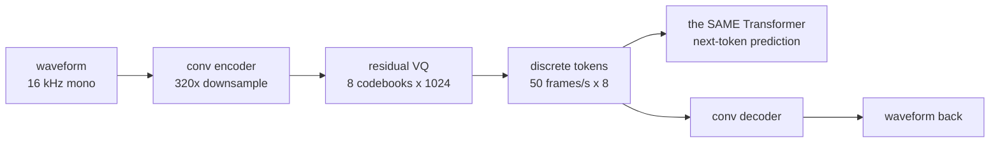

Four pieces, strictly ordered because each needs the one before it:

| # | module | what it is | cost |
|---|---|---|---|
| 1 | `io.py`, `features.py` | waveform → log-mel, and Griffin-Lim back to sound | CPU, instant |
| 2 | `vq.py`, `codec.py` | the RVQ-VAE. The one new training loop | hours on the 3090 |
| 3 | `delay.py`, `lm.py` | the existing transformer over codec tokens | hours |
| 4 | `text.py`, `speech.py` | TTS and ASR, as one model in two orders | hours |

---

## Part 1 — the front end

A waveform at 16 kHz is 16,000 numbers a second and almost none of them mean anything alone.
What means something is **which frequencies are present, and when**.

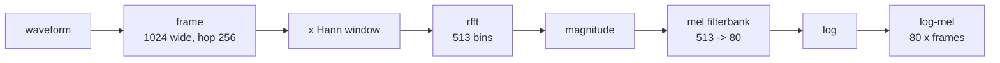

Three steps there are worth a sentence each.

**Why a window.** Cutting a frame out of a signal multiplies it by a rectangle, whose
Fourier transform is full of side-lobes — so one pure tone smears across every bin
(*spectral leakage*). A Hann window tapers to zero at both ends, trading a slightly wider
main lobe for side-lobes ~30 dB lower. It is also what makes the transform **invertible**:
at a hop of `n_fft/4` the overlapping Hann windows sum to a constant (the COLA condition),
so overlap-add reconstructs the original exactly. `tests/test_audio.py` asserts that to
1e-5, because if it is not true then every reconstruction number in the codec is partly a
measurement of the window.

**Why mel.** 513 linear bins spend most of their resolution above 4 kHz, where hearing
barely distinguishes anything. The mel scale is roughly linear below 1 kHz and logarithmic
above it. Collapsing onto 80 triangular filters throws away what we cannot hear.

**Why log.** Loudness is perceived logarithmically and raw magnitudes span six orders of
magnitude; a network trained on linear magnitudes spends its capacity on the loudest frames.

**Griffin-Lim** then guesses the phase back — start from random phase, invert, re-transform,
keep the original magnitudes with the new phase, repeat. The reason to build it is not
quality; it is that **you can listen to what the model sees**:

```
.venv/bin/python -m aksharallm.audio tone --out /tmp/tone.wav
.venv/bin/python -m aksharallm.audio spec /tmp/tone.wav
.venv/bin/python -m aksharallm.audio roundtrip /tmp/tone.wav --mel
```

Measured here: momentum earns its name. At 30 iterations, spectral convergence is **0.137**
with `momentum=0` and **0.040** with `momentum=0.99` — 30 fast iterations beat 100 plain
ones. The `momentum/(1+momentum)` denominator in the update is not decoration; feeding the
raw momentum in overshoots and converges *worse* than no momentum at all.

### Resampling, from scratch

LJSpeech is 22,050 Hz and LibriSpeech is 16,000, and the codec must see one number or its
token rate means two different things in one dataset. Resampling is not "take every other
sample" — that folds every frequency above the new Nyquist rate down into the audible band
as a tone that was never there, and it cannot be undone. `io.resample` reconstructs the
band-limited signal with a Kaiser-windowed sinc and reads it at the new times, with the
sinc **stretched** when going down so its cutoff drops to the lower Nyquist rate. That one
factor is the whole of anti-aliasing.

Measured: a 10 kHz tone resampled 22,050 → 16,000 comes out **700× quieter**, not folded to
6 kHz. Round-tripping 16k → 22.05k → 16k is accurate to **1e-5**.

> **A bug worth keeping.** The polyphase kernel table is indexed by the *residue*
> `(j·down) mod up`, not by `j`. Indexing a table built in `j`-order by that residue is
> still a valid resampler and merely time-warps by up to one sample — inaudible on a low
> tone, and it destroyed a 6 kHz one (round-trip error 3e-5 → 0.77).

---

## Part 2 — the codec

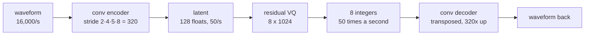

**The arithmetic that decides everything.** 16,000 samples a second downsampled by 320 is
**50 frames a second**. Eight codebooks of 1,024 entries is 10 bits each, so 80 bits a frame
= **4 kbps**, against 256 kbps for the 16-bit PCM it came from — a **64× compression**. And
50 × 8 is the sequence length the transformer downstairs pays for: ten seconds of speech is
4,000 tokens. The frame rate is the single most consequential number in the phase.

### Vector quantization, and its three problems

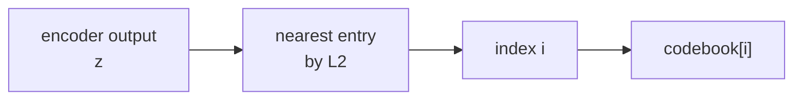

1. **There is no gradient.** `argmin` differentiates to zero everywhere, so the encoder
   would never learn. The **straight-through estimator** outputs the codebook entry forward
   and pretends the quantizer was the identity backward: `z + (q − z).detach()`. Detach the
   wrong side and it trains smoothly and reconstructs noise.
2. **The codebook has to learn too**, and straight-through gives it nothing. We use an
   **EMA** — the same k-means step, without the optimizer, which is far less sensitive to
   the learning rate. A codebook is not really a parameter being descended; it is a set of
   centroids being tracked. It is a `buffer`, not a `Parameter`, so weight decay cannot
   quietly shrink every entry towards the origin between updates.
3. **Codebook collapse is [router collapse](15-moe.md) again.** A handful of entries win
   early, receive all the assignments, and the rest never train — so a 1,024-entry codebook
   is quietly a 40-entry one, reconstruction plateaus, *and the loss curve looks fine*. Same
   countermeasures: usage counted every step, plus **dead-code restart** — an entry nobody
   has chosen for `restart_after` steps is reinitialised to a random encoder output, which
   is a place we know data actually lives.

**Residual VQ** is one idea on top: quantize `z`, quantize what the first codebook got
*wrong*, and repeat. Two properties fall out, and both are used:

- **the prefix is a valid code**, so bitrate becomes a decode-time dial rather than a
  property of the checkpoint. That is the demo of the phase;
- **the codebooks are ordered by importance**, which is what the delay pattern exploits.

### The reconstruction loss

**Not L2 on the waveform.** That is phase-sensitive: shift a signal by one sample — 60
microseconds, inaudible — and the loss is enormous. The loss that works is on **STFT
magnitudes at several window sizes**: short windows catch transients (the burst of a /t/),
long ones catch pitch. Each scale contributes two pieces, doing opposite jobs:

| term | dominated by | fixes |
|---|---|---|
| spectral convergence, on linear bins | the **loud** parts | the formants |
| L1 on **log-mel** bands | the **quiet** parts | the noise floor, the breath |

> **Why the log term is on mel bands and not FFT bins — measured, not assumed.** One
> 2,048-point frame of a harmonic signal has magnitudes spanning **6e-6 to 211**, and more
> than half the bins sit at or below any sane floor. An L1 on *their* logs is mostly a
> measurement of FFT numerical noise: a one-sample circular shift scored **0.66**. A mel
> band sums dozens of bins and is never at the numerical floor. The fix is structural, not
> a better-chosen epsilon.

An adversarial term on top is what takes a codec from "clearly the same words" to "hard to
tell apart", and it is deliberately **not** here: a GAN that fails to converge is
indistinguishable from a codec that fails to converge.

### Running it

```bash
# no download, ~30 s, 13 minutes of synthetic vowel babble
.venv/bin/python -m aksharallm.audio corpus --out data/audio/synth --clips 400
scripts/audio.sh codec-synth

# the real thing: 24 h of one reader, 2.6 GB download
.venv/bin/python -m aksharallm.audio fetch ljspeech
.venv/bin/python -m aksharallm.audio pack data/audio/ljspeech/LJSpeech-1.1/wavs --out data/audio/lj
scripts/audio.sh codec-lj
```

Measured on the synthetic corpus, 1,500 steps, ~4 minutes on the 3090 at **168 audio-seconds
reconstructed per wall-clock second**: loss 20.6 → 6.0, val 7.10 → **5.48**, codebook usage
climbing from 1.5% to 38% as dead-code restart does its work. The bitrate ladder at that
point:

| codebooks | kbps | vs PCM | convergence | MCD dB |
|---|---|---|---|---|
| 1 | 0.45 | 569× | 0.714 | 13.66 |
| 2 | 0.90 | 284× | 0.694 | 11.89 |
| 4 | 1.80 | 142× | 0.685 | 11.83 |
| 8 | 3.60 | 71× | 0.676 | 12.11 |

That is a **bad codec** — 1,500 steps is a smoke test, and the numbers are here to show the
machinery works and the ladder is monotone, not to claim quality. `configs/codec-lj.yaml`
budgets 150,000 steps.

**The real one, `codec-lj`, measured 2026-11-15** (150,000 steps, finished 2026-08-10;
`audio report checkpoints/codec-lj/ckpt_best.pt --corpus data/audio/lj --clips 16`, on
held-out LJSpeech clips):

| codebooks | kbps | vs PCM | convergence | MCD dB |
|---|---|---|---|---|
| 1 | 0.50 | 512× | 0.371 | 6.31 |
| 2 | 1.00 | 256× | 0.286 | 4.23 |
| 4 | 2.00 | 128× | 0.226 | 3.11 |
| 8 | 4.00 | 64× | 0.191 | **2.60** |

At 4 kbps the MCD is **2.60 dB**, inside the under-4 "very close" band, and every
codebook is in use: 61–70% of the 1,024 entries, perplexity 620–720, no collapse anywhere.
One codebook alone (0.5 kbps) is already at the edge of "recognisably degraded". This is
the first codec in this repo good enough to build on, and `audiolm-lj` (Part 4) does.

---

## Part 3 — the delay pattern

The codec hands the language model **eight integers per frame**, and they are not
independent: codebook 2 quantizes the error codebook 1 left behind. Three ways to handle
that:

```
flatten     →   [c⁰₀ c¹₀ … c⁷₀ c⁰₁ …]     8x the positions. 10 s becomes 4,000 tokens.

parallel    →   predict all 8 of frame t at once from frames < t.
                Fast, and WRONG: it assumes the eight are independent given the past,
                and the whole point of a residual is that they are not.

delay       →   book 0:  c⁰₀  c⁰₁  c⁰₂  c⁰₃
                book 1:   ·   c¹₀  c¹₁  c¹₂
                book 2:   ·    ·   c²₀  c²₁
                book 3:   ·    ·    ·   c³₀
```

Codebook *k* shifted right by *k* frames. Now everything in one column can be predicted at
once, because by the time `c¹₀` is predicted, `c⁰₀` is already in the past and visible. The
sequence grows from `T` to `T + N − 1` — seven extra positions on five hundred — instead of
to `8T`, and the dependency chain is preserved rather than assumed away. One more column goes
in front of it: a start column of BOS ids, because generation has to begin from *something*
and training must show the model that same start (`lm.training_pair`; § Two layout bugs).

**Trap 4 lives here**, and it is gotcha #2's family: an off-by-one trains perfectly and
generates garbage, because the decoder is handed codebook 1 of frame 5 alongside codebook 0
of frame 4 and reconstructs an interleaving of two moments. The defence is that
`undelay(delay(x)) == x` is asserted exactly, and the padding is a **distinct token id**
rather than a zero that could be mistaken for code 0.

### What the model changes

Almost nothing, and that is the point. `Transformer.forward` gained two optional arguments,
both exact no-ops on every existing path:

- `inputs_embeds` — the audio LM sums eight embeddings per position, one per codebook, so it
  supplies them itself. Concatenating instead would make `d_model` depend on `n_codebooks`;
  summing works because the tables are separate, so code 5 of book 0 and code 5 of book 3
  are different vectors.
- `return_hidden` — it needs **eight heads**, because the eight codebooks have eight
  unrelated vocabularies and a single head over `8 × 1024` would let the model put mass on a
  book-3 code while predicting book 0.

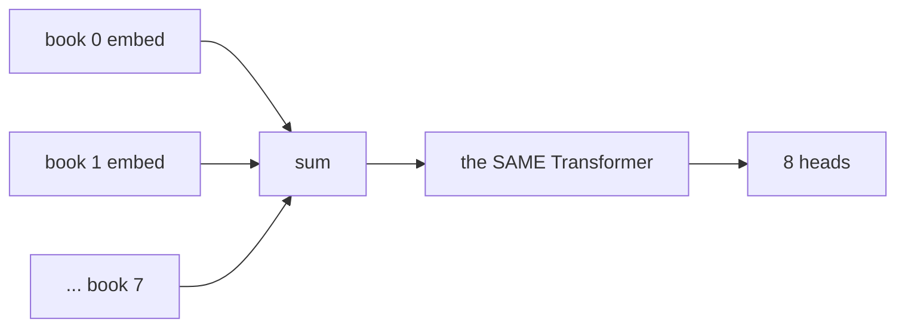

**The number to watch is `ln(codebook_size)`.** At step 0 a uniform distribution over 512
codes costs exactly `ln 512 = 6.238` nats. Measured on the first line of the smoke run:
**6.3145**. That is the cheapest possible check that the delay pattern, the target masking
and the eight heads are all wired correctly — the same argument as the DPO loop's
`ln 2 = 0.6931`.

**And the loss is not what says it is working.** A codec LM's loss falls smoothly while it
generates plausible gibberish, because most of the entropy lives in the high codebooks,
which are nearly noise and cannot be predicted by anyone. Sample audio and listen.

---

## Part 4 — TTS and ASR

Both directions are one idea already implemented in [`train/sft.py`](06-posttraining.md):
**put two things in one sequence and take the loss on only one of them.**

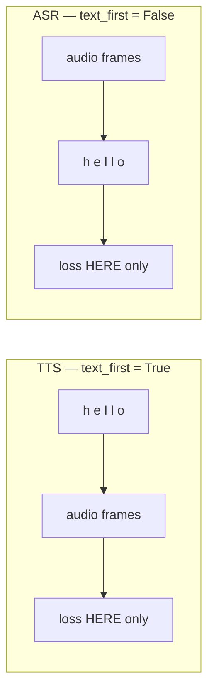

That is the assistant-only mask with audio in the assistant's role. The only thing audio
changes is *what* is on each side.

**Text is character level**, not the repo's BPE, for one reason: **TTS needs a spelling, not
a meaning.** A BPE merge turns "nation" into one token, which is what a language model wants
and what a text-to-speech model cannot use — it has to know the sequence is n-a-t-i-o-n to
make those sounds in that order.

**Decoding follows the task, not the codebase.** `speak` samples (greedy TTS is a flat
monotone, because the most likely continuation of any prosody is the average of all
prosody); `transcribe` is greedy (transcription has a right answer and sampling can only
move away from it).

### The honest-measurement problem

**TTS cannot be scored by a number.** Mean opinion score needs humans. What we report:

| number | what it sees | what it misses |
|---|---|---|
| spectral convergence | whether the loud spectrum is in the right place | phase — robotic but correct |
| **MCD** | the spectral *envelope* — formants, i.e. which vowel | pitch, timing, noise |
| **WER** (ASR) | whether the words came out | everything about how they sound |
| intelligibility | our ASR's WER on our TTS output | quality. **It is not quality.** |

Two traps here, both guarded:

- **MCD assumes frame-for-frame alignment.** True for a codec, where the output is the input
  reconstructed. False for TTS, where the model may say the right words at a different rate
  — that is *correct* and scores terribly. Reporting an unaligned MCD as if it meant
  something is the mistake `speech.py`'s docstring exists to prevent.
- **Intelligibility is self-referential.** A bad ASR model makes a good TTS model look bad,
  so the ASR model's own WER on real speech has to be reported beside it.

> **MCD needed rescuing, and the story is the lesson.** With an *absolute* log floor it
> scored a clip against itself-plus-inaudible-noise (amplitude 1e-4, 77 dB down) at **86 dB**
> — the metric was not measuring the signal at all, because a mel band 120 dB down is
> numerically far from one 160 dB down and *perceptually identical to it*. With a **relative**
> floor 40 dB below the clip's own peak, the same comparison scores **0.23 dB**, noise 34 dB
> down scores **4.2 dB** (the published "very close" band), and it rises monotonically with
> distortion. The constant is calibrated, not guessed — and because it is calibrated on
> constructed distortions rather than against a published toolchain, it is a number to
> compare *our* checkpoints with, not one to put beside a paper's.

### Two layout bugs, found before the first real run

Neither showed on the synthetic corpus, and both are gotcha 2's family: the model trains on
one arrangement of the sequence and generation uses another.

1. **Generation starts from a BOS column that training never contained.** `generate` and
   `speak` begin with `[BOS]` in every codebook and predict each column after it. Training
   fed `delay(codes)` alone, so the first real column was never a target and the BOS
   embedding was never trained. A model that had *memorised* a clip could not regenerate
   it. `lm.training_pair` now prepends the column, and
   `test_greedy_generation_reproduces_a_memorised_clip` fails without it. Every audio LM
   sample written before 2026-11-15 began from an untrained context.
2. **Padding went between a sentence and its audio.** `tts_batch` padded the texts to one
   width and then appended the audio, so a short sentence had `[PAD]`s between its last
   letter and its first frame, and the audio started at a different position in each row.
   `speak` never sees those pads. The synthetic corpus's texts were all one length and hid
   it. LJSpeech runs from 1 to 10 seconds. `speech.utterance_loss` lays out each row the
   way inference does, `[text][BOS + audio]`, padded only at the end. A ragged batch now
   scores exactly what its rows score one at a time, and a memorised pair comes back
   through `speak` and `transcribe`.

### TTS on LJSpeech: `audiolm-lj`

`data.task: tts` makes the trainer read whole utterances with their transcripts
(`dataset.UtteranceDataset`, never windows, because the audio has to be all of the sentence)
and train with `utterance_loss`. The character tokenizer is built from the transcripts
(lower-cased, punctuation kept: a comma is a pause) and saved in every checkpoint. A resume
reuses the saved one, because the tokenizer is the text embedding's index (gotcha 3).

```bash
.venv/bin/python -m aksharallm.audio encode checkpoints/codec-lj/ckpt_best.pt \
    --corpus data/audio/lj --out data/audio/lj-codes        # once, ~1 h on the CPU
scripts/audio.sh audiolm-lj                                 # 42.3M, 60k steps
.venv/bin/python -m aksharallm.audio tts-report checkpoints/audiolm-lj/ckpt_best.pt
```

The config is sized from the corpus: the longest clip is 505 frames and the longest
transcript 189 characters, so `max_frames: 512` and `max_text: 192` drop nothing.

**How it is scored: one independent judge, three rows.** The intelligibility trap above
assumed the audio LM's own ASR as the judge. This repo has a better one now: the dictation
recogniser (`asr-libri460`, 5.25% WER on test-clean; [doc 23](23-speech-recognition.md)),
trained on other data by another objective. `tts-report` speaks held-out sentences and has
it transcribe three versions of each:

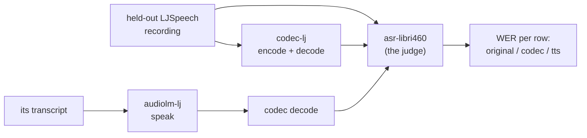

Each row reads against the one above it: **original** is the judge's own error on this
voice, **codec** adds what 4 kbps loses, **tts** adds what the model gets wrong. The TTS is
given each sentence's *real* duration (`speak` needs a frame count, and there is no stop
token), which a deployed system would not have, and the report says so. WAVs of all three
are written side by side, because intelligibility is still not quality.

### Measured: `audiolm-lj` (2026-11-18)

60,000 steps in **2 h 1 min** (0.12 s/step, ~365k codes/s; the estimate was 3–4 h). Step-0
loss sat on ln(1024) as it should. **Validation bottomed at step 22,000 (4.666) and rose for
the remaining 38,000 steps** to 4.758 while the training loss kept falling to 3.65. That is
memorisation: 24 hours of one voice, about 27 passes over the corpus by step 22k.
`ckpt_best.pt` is step 22,000, and that is what was scored. The last two-thirds of the
budget bought nothing.

`tts-report`, 20 held-out sentences, judged by `asr-libri460` (greedy):

| row | WER | CER |
|---|---|---|
| original recording | 8.7% | 3.1% |
| through the codec | 8.7% | 2.7% |
| **TTS (step 22k)** | **65.7%** | **34.8%** |

The codec costs the judge nothing. The TTS is **intelligible but slurred**: two thirds of
the characters come through, and no utterance ran away (0 hypotheses longer than twice the
reference). What the judge heard:

> said: *based on its experience during this period the secret service now recommends that
> additional personnel be made available to prs*
> heard: *es on its experienced during this period the secret service now recommons that a
> dist at additinal personal bealable preval ard*

> said: *so that these arrangements can be made permanent without adversely affecting the
> operations of the service's field offices*
> heard: *so thit these arrangements can be made perminage without dead variuling the
> operations of the service he speelss field fofhices*

In the transcripts read so far, short common words come through and long rare ones smear
into near-misses ("perminage", "variuling"), with the ends of long sentences the worst. That
is a reading of a handful of examples, not a measurement. Whether it *sounds* like
LJSpeech is a question for `logs/audio/tts-audiolm-lj/NN-tts.wav` beside `NN-original.wav`:
no number here can answer it.

Two limits the number hides. The TTS was **given each sentence's real duration**, and there
was no command to speak arbitrary text. Both are addressed below. The overfitting is the
third, and more speakers would address it better than more dropout.

### Speaking any text, and knowing when to stop

```bash
.venv/bin/python -m aksharallm.audio speak checkpoints/audiolm-lj/ckpt_best.pt \
    "The quick brown fox jumps over the lazy dog, and nobody is surprised."
```

writes `logs/audio/speak/<first words>.wav`. The model has to be told how long to talk, in
one of three ways, in this order: `--frames N` if given; the model's own **stop head** if it
has one; else the corpus's median **frames per character** (3.29 on LJSpeech, saved in every
TTS checkpoint by the trainer). It takes 13 s on the CPU. The first
model, judged by the recogniser on that sentence: *"a quite bron cocx jumps of rithe lays ow
lesse darts"*. That is about what 65.7% WER sounds like on a sentence it has never seen.

**The stop head** (`audiolm.predict_stop: true`) is one logit on every audio position: has
the utterance ended? The delay pattern finishes codebook 0 first, so "ended" means codebook
0 has no frame at this column (`speech.stop_targets`). Generation stops sampling codebook 0
the moment the head says so, and finishes the other books' delay tail. A sentence gets at
least one frame, and at most `max_frames`. It is trained by a binary cross-entropy added
to the audio loss, while the **validation number stays the audio loss alone**, so a run
with a stop head reads on the same scale as one without.
`test_a_memorised_utterance_is_spoken_at_its_own_length_with_no_length_given` memorises
utterances of 9 and 5 frames and requires each back, whole, at its own length. It fails
without the stop loss and with labels one column early.

`configs/audiolm-lj-stop.yaml` is the first run plus the head, and **25,000 steps instead of
60,000**, because validation bottomed at 22,000. `tts-report --duration own` lets the model
choose its length. It ran as `logs/queue/tts-stop.sh` (2026-11-19, 53 min). That queue
also scored the first model under its frames-per-character fallback, so "own length" has a
baseline.

**Measured (2026-11-19).** The run's val loss bottomed at **4.686 at step 18,000** and stayed
flat to 25,000. The first run reached 4.666, so the shorter schedule cost a little. The
same 20 held-out sentences were judged by the same recogniser:

| model | length from | WER | CER |
|---|---|---|---|
| original recording | – | 8.7% | 3.1% |
| codec | – | 8.7% | 2.7% |
| `audiolm-lj` (step 22k) | real recording | 65.7% | 34.8% |
| `audiolm-lj` (step 22k) | 3.29 frames/char | 60.4% | 32.7% |
| `audiolm-lj-stop` (step 18k) | real recording | **47.1%** | 23.1% |
| `audiolm-lj-stop` (step 18k) | **its own stop head** | **54.9%** | 25.7% |

- **The stop head works.** It chose lengths at a median of 1.07× the real recording (range
  0.92–1.36×). Judged sentence by sentence, it was no worse than being handed the real
  length (better on 6, worse on 12, p 0.24), or than the frames-per-character rule (11–8,
  p 0.65).
- **The new run is clearer when both runs are given the real length:** it was better on 16
  of 20 sentences and worse on 3 (sign test p 0.004), despite a slightly worse val loss.
  Two things changed at once, so this does not say which one did it. The stop loss is one;
  the shorter cosine schedule, which decays sooner, is the other.
- On the fox sentence, which the model has never seen, the recogniser heard *"the quick
  brown fox jumps ofe zy dos and noblty is surpriss"* from the new model (5.6 s, its own
  length). From the old one it heard *"a quick brown fox over the lacied ta and is
  surprus"* (4.5 s, which dropped "jumps"). WAVs: `logs/audio/speak/fox-*.wav`.

With 20 sentences sampled at temperature 0.8, a difference of five points means nothing.
Only paired counts like these mean anything.

### Does the codec carry other voices? (2026-11-19)

The TTS overfits one voice, and the obvious fix is more voices. But a multi-speaker TTS
writes *codes*, and the codec turns them back into sound. If `codec-lj`, trained on 24 hours
of one reader, cannot rebuild other people, more speakers in the audio LM cannot help: its
output can never sound better than the codec's reconstruction. So the codec was measured
first, on the CPU:

```bash
python -m aksharallm.audio codec-transfer checkpoints/codec-lj/ckpt_best.pt --cpu
```

It runs two sets of clips through the codec. The first is 64 LJSpeech clips from the
codec's own held-out split. The second is 120 LibriSpeech `test-clean` clips, 3 from each of
40 speakers it never heard. For every clip it records MCD at 1, 2, 4 and 8 codebooks, and
`asr-libri460`'s transcript of the original and of the reconstruction.

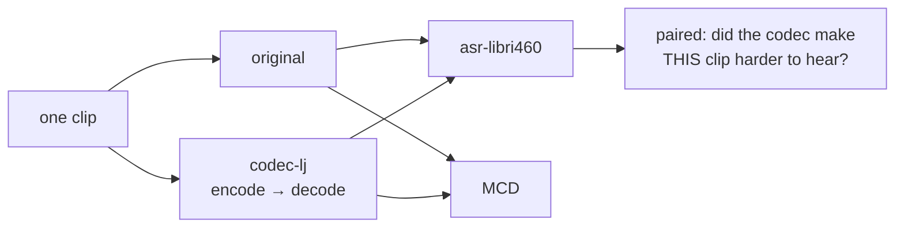

| | clips | MCD @1 | @2 | @4 | @8 | WER original | @4 | @8 |
|---|---|---|---|---|---|---|---|---|
| its own voice (LJ, held out) | 64 · 1 voice | 6.24 | 4.34 | 3.16 | **2.53** | 6.3% | 7.6% | 7.2% |
| voices it never heard (LibriSpeech) | 120 · 40 voices | 13.88 | 11.61 | 10.12 | **9.12** | 9.1% | 21.4% | 15.3% |

Paired, clip by clip, at 8 codebooks:

- **Its own voice:** the codec made the recogniser worse on 12 clips and better on 6, and
  left 46 the same (p 0.24). That is no measurable damage.
- **Other voices:** worse on **60**, better on 13, the same on 47 (p 2×10⁻⁸). At 4 codebooks
  it was worse on 75 and better on 8.

**It degrades badly.** At full bitrate the codec is further from an unseen voice (9.1 dB)
than from its own voice at a *single* codebook (6.2 dB). Only 7 of the 40 speakers come out
under 4 dB. The spread is wide: from 2.7 dB for the best speaker to 24.8 dB for the worst,
and 80% of clips are above 4 dB. The recogniser still gets most words: CER goes 3.0% →
5.9%. So the *words* mostly survive while the *voice* does not. But for a TTS whose job is
to sound like a person, that is the part that matters.

Two explanations were ruled out before believing this:

- **Not loudness.** Normalising each clip to LJSpeech's level before encoding left MCD where
  it was (10.1 → 10.1 dB on the first speaker, and similar on the rest).
- **Not background noise.** LibriSpeech is read at home and LJSpeech in a studio, so the
  noise between words could have inflated MCD. It did not: keeping only frames within
  10 dB of each clip's peak, which is the speech itself, made the gap *wider* (2.9 vs
  11.4 dB).

What it cannot see: MCD measures the spectral envelope, not identity. A codec that turned
every speaker into one voice could score well on both columns. And the judge trained on
LibriSpeech, so it is on home ground for the second row. That is why each row is read
against its own original, never against the other row. Listen:
`logs/audio/codec-transfer-codec-lj/other/NN-codec8.wav` beside `NN-original.wav`, or pick
`data/asr/test-clean` in the Audio tab's ladder. The tab's **Does the codec carry other
voices?** panel shows this report.

**Which part fails: the codebooks, or the encoder and decoder?** If only the codebooks were
missing the new voices, re-fitting them would be nearly free (k-means, no GPU). So the same
clips were rebuilt four ways (32 LJ held-out, 40 LibriSpeech speakers, one clip each):

| | MCD own voice | MCD new voices | rounding error, new voices | WER new voices (orig 9.2%) | per clip vs original, new voices |
|---|---|---|---|---|---|
| **no rounding** (encoder → decoder directly) | 2.29 | **9.49** | – | 17.8% | 18 worse / 4 better (p 0.004) |
| the codec as it is (8 books) | 2.51 | 9.20 | 12.8% | 15.0% | 19 / 5 (p 0.007) |
| codebooks re-fitted on LibriSpeech train-clean-100 + LJ | 2.60 | 9.47 | 7.6% | 17.5% | 21 / 3 (p 0.0003) |

Skipping the rounding entirely is **no better**. The continuous latent, decoded directly, is
already 9.5 dB from a new voice, so the loss happens in the encoder and decoder, before any
codebook is involved. The codebooks *do* fit new voices worse (12.8% of the latent's energy
lost in rounding against 4.7% for LJ), and re-fitting them halves that, but nothing improves,
because the decoder cannot render those voices anyway. A codebook-only fix is ruled out.

**So the codec has to be retrained on many voices — encoder and decoder, not only the
codebooks — before the audio LM is.**

### The many-voices codec: `codec-many` (built and trained 2026-11-19)

`configs/codec-many.yaml` is `codec-lj`'s architecture exactly, with two changes:

- **It reads three corpora by weight** (`data.sources`): LJSpeech 0.20, LibriSpeech
  train-clean-100 0.17 and train-clean-360 0.63, which is 488 hours and ~1,170 voices. Weighted by
  hours, LJ would be 5% of every batch and the voice the codec already knows could drift.
  `MixedAudioDataset` gives every batch `floor(16 × weight)` rows from each corpus and hands out
  the leftover rows by the fractional parts, so a weight is a corpus's exact expected share.
- **It starts from `codec-lj`'s weights** (`train.init`), with a fresh optimizer and its own
  warm-up. The two configs must describe the same codec; a different codebook size or stride
  is refused rather than loaded. A resume always wins over the init, so restarting a stopped run
  continues it.

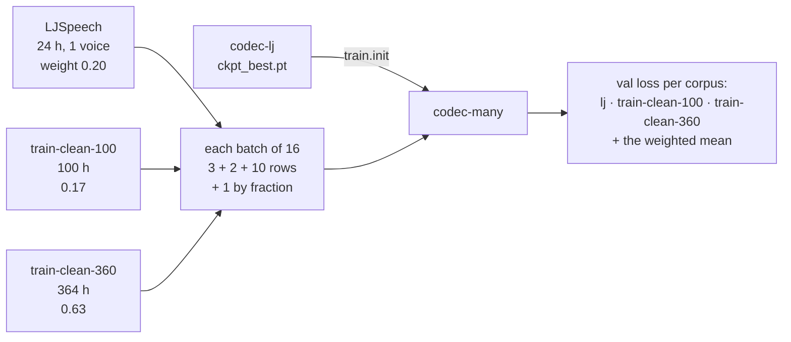

Validation is reported **per corpus** beside the weighted mean (`val_loss_lj`,
`val_loss_train-clean-100`, ...). The question this run has to answer is whether the new voices
improve *without* the old one getting worse, and a single blended number cannot show that.
The best checkpoint is chosen on the weighted mean.

```bash
scripts/audio.sh codec-many        # ~2.7 h at codec-lj's 0.096 s/step, 100k steps
python -m aksharallm.audio codec-transfer checkpoints/codec-many/ckpt_best.pt --cpu
```

**The gate before any TTS is built on it** is the same `codec-transfer` report: the
LibriSpeech row has to improve and the LJSpeech row must not get worse, both read per clip.
A 12-step CPU smoke run on the real corpora, starting from `codec-lj`, already shows the
starting gap in the trainer's own terms: val **2.29 on LJ against 3.77 and 5.26** on the two
LibriSpeech tails. It also shows codebook usage at 18–24% on the new mix against codec-lj's
61–70% on LJ, so the dead-entry restarts will have work to do early.

### A content codebook: `codec-many-content` (built and trained 2026-11-19)

Codebook 0 of today's codec carries whatever cuts the reconstruction error most, so it holds
the words and the voice together. A TTS over those codes has to guess the voice from text,
which text cannot tell it. SpeechTokenizer and Mimi split the two instead: codebook 0 is pulled
towards the states of a speech-recognition encoder, which was trained to keep the words and
ignore the speaker. The words then sit in codebook 0, which text predicts well, and the voice
in codebooks 1–7, which is where a speaker id or a reference clip can act.

Our own recogniser is the teacher: `asr-libri460`, frozen ([doc 23](23-speech-recognition.md)).

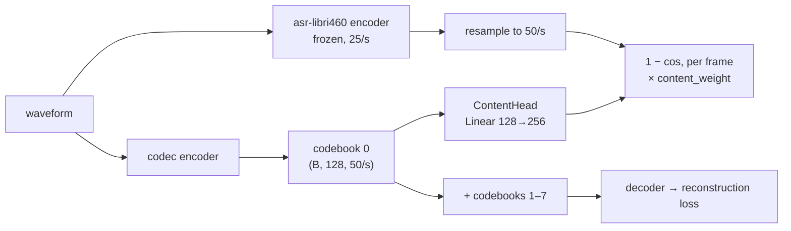

- **Only a projection is added**, about 33k parameters. It is saved next to the codec in the
  checkpoint (`content_head`), never inside its weights, so everything that reads a codec
  checkpoint is unaffected.
- **Cosine, not squared error.** The recogniser's states are layer-normalised, so their
  direction carries the phone. A squared error would mostly teach the projection their size.
- **The loss cannot be switched on or off across a resume.** Doing that would change the
  optimizer's groups and the objective at once, so it is refused. Start a new run with
  `train.init` instead.
- **The judge's caveat.** The same recogniser scores the codec in `codec-transfer`. This loss
  shapes the *codes* to match its encoder; it does not train the *reconstruction* to please
  it, which is the trap named above. Still read a content-trained codec's WER rows next to MCD
  and a second judge (Whisper).

`configs/codec-many-content.yaml` is `codec-many.yaml` with only `loss.content_weight: 1.0`
and `loss.content_teacher` added, so the pair answers this one question. On the CPU both run
at the same 4.2 audio-s/s, because there the codec dominates the step. On the card the
recogniser's forward pass is a larger share. Measured on the 3090: 0.109 s/step against
0.098, **12% slower**, not the 30–50% guessed. Both were trained as a controlled pair; the
results are below.

### Does it still sound like that person? A speaker model (built and trained 2026-11-19)

Neither MCD nor WER can see voice identity. A codec could turn every speaker into one voice
and still score well on both. So `audio/speaker.py` is a speaker embedding, from scratch: it
maps a clip to a 192-number unit vector, trained so two clips of one person point the same
way and two people point apart.

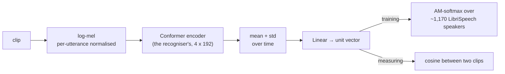

- **The encoder is the recogniser's** (`Recognizer.encode(hidden=True)`), with its output
  layer unused.
- **Per-utterance normalisation**, unlike the recogniser. The recogniser needs loudness to stay
  silent on faint hiss; a speaker model must not learn to tell people apart by their
  microphone's level.
- **AM-softmax adds a margin:** the right speaker has to win by `m = 0.2`, not just win. That
  is what keeps *unseen* speakers apart once the classifier is thrown away.
- **The checkpoint is chosen on unseen speakers' EER** (dev-clean's 40), not on how well it
  sorts the 1,170 it trained on. test-clean's 40 give the final number (`audio speaker-eval`).
  EER is the threshold at which false accepts equal false rejects.

**A baseline to beat:** an *untrained* network already scores **27% EER** on dev-clean (21
CPU steps, so effectively random weights), not the 50% of random scores. Averaged spectral
statistics carry some identity before anything is learned. A trained model is only worth
its name well below that.

In `codec-transfer --speaker <ckpt>` it adds a voice-identity column: the cosine between a
clip and its own reconstruction. A cosine alone means nothing, so the same model also scores
two references from the originals. One is two *different* clips by the same speaker, which is
what "the same voice" scores; the other is two different speakers. A reconstruction near the
first kept the voice; one near the second did not.

```bash
scripts/audio.sh speaker-libri                                  # ~20k steps, ~16 min on a 3090
python -m aksharallm.audio speaker-eval checkpoints/speaker-libri/ckpt_best.pt
python -m aksharallm.audio codec-transfer checkpoints/codec-lj/ckpt_best.pt --cpu \
    --speaker checkpoints/speaker-libri/ckpt_best.pt
```

A run with a smaller sample than the default (64 LJ clips, 3 x 40 speakers) writes its JSON
under its own name (`...-lj6-test-cleanx1.json`), and the Audio tab never shows one as the
result. A quick check came within one command of overwriting the full report. The tab's
panel now has one row per codec, so `codec-lj` and `codec-many` can be read side by side.

### Measured: three codecs, one judge, paired per clip (2026-11-19)

Both new codecs trained 100,000 steps on the 3090 (2 h 49 m and 3 h 10 m), and the speaker
model 20,000 steps (16 min). `speaker-eval` on test-clean's 40 unseen speakers (160 clips,
12,720 pairs): **EER 0.42%**, against 27% untrained. Then `codec-transfer --speaker` on all
three codecs, with the default sample: 64 held-out LJ clips ("home") and 120 test-clean clips
from 40 speakers ("other").

| codec | MCD@8 home | MCD@8 other | WER @8 home (orig 6.3%) | WER @8 other (orig 9.0%) | voice cos @8 other |
|---|---|---|---|---|---|
| `codec-lj` | **2.54** | 9.12 | 7.5% | 15.5% | 0.28 |
| `codec-many` | 2.96 | **3.73** | 7.3% | **10.0%** | **0.45** |
| `codec-many-content` | 3.01 | 3.79 | 7.5% | 10.6% | 0.45 |

The voice references, from the same speaker model on the originals: two clips of one speaker
score **0.825**, two different speakers **0.011**.

Paired per clip (worse / better, sign test):

| comparison | other voices, words @8 | other voices, voice @8 | LJ, words @8 | LJ, voice @8 |
|---|---|---|---|---|
| `codec-many` vs `codec-lj` | **15 / 53, p 4e-6** | **19 / 101, p 1e-14** | 9 / 9, p 1 | 61 / 3 (worse), p 5e-15 |
| `-content` vs `codec-many` | 23 / 16, p 0.34 | 55 / 65, p 0.41 | 8 / 6, p 0.79 | 36 / 28, p 0.38 |

What it says:

- **Training on many voices fixed the codec for many voices.** MCD on new speakers fell from
  9.1 to 3.7 dB, better than `codec-lj` managed at *one* book on its own voice. At 8 books the
  recogniser's errors are no longer significantly worse than on the original audio (30 / 20
  clips, p 0.20; `codec-lj` was 60 / 12, p 8e-9). Every one of the 120 clips has a lower MCD.
- **LJ paid a little.** MCD@8 2.54 → 2.96 on 64 of 64 clips, and the speaker model scores 61
  of 64 LJ reconstructions further from the original. The *words* did not move (9 / 9). The
  LJ val loss jumped from 2.29 to 3.02 in the first 1,000 steps (fresh optimizer, new data)
  and was still falling at the end (2.57 at step 99k), as was every corpus's. The run was
  not finished learning; more steps would likely recover some of LJ.
- **The content codebook bought nothing we can measure.** Every paired comparison against
  `codec-many` is a coin toss (all p > 0.3), at 12% more time per step. Its content loss
  ended at 0.545, i.e. codebook 0 reaches a cosine of about 0.45 with the recogniser's
  states. What this report *cannot* say is whether the words moved into codebook 0, which was
  the point: that pays off in a TTS that predicts codebook 0 from text, and needs a probe of
  codebook 0 alone (WER with only book 0 decoded, or a linear phone probe). **Tested
  2026-11-20 (below): it did not.** Book 0 alone transcribes no better from the content
  codec than from the plain one.
- **The voice column needs a caveat of its own.** Even `codec-lj` on LJ, at MCD 2.54, scores
  only 0.60 against a same-speaker reference of 0.87. A reconstruction of the *same* clip
  sounds less like the speaker, to this model, than a different clip does. The speaker model
  trained on clean recordings and reads codec artefacts as a channel change. So compare
  voice cosines between codecs, which works, and do not read 0.45 as "half the voice is gone".

**For the TTS:** use `codec-many` (it is: `audiolm-many`, below). It is the gate the audio LM
was waiting for, and the content variant offers nothing to justify its cost: the codebook-0
probe (below) found nothing either.

### Many voices, one TTS: `audiolm-many` (built 2026-11-19, trained 2026-11-20)

`audiolm-lj-stop` speaks in one voice because it only ever heard one. With `codec-many`
carrying other voices, the same audio LM can be trained on all of them, if it is told *whose*
voice each sentence is in. Otherwise it would have to guess the voice from the text, which
says nothing about it, and would learn an average of 1,170 speakers.

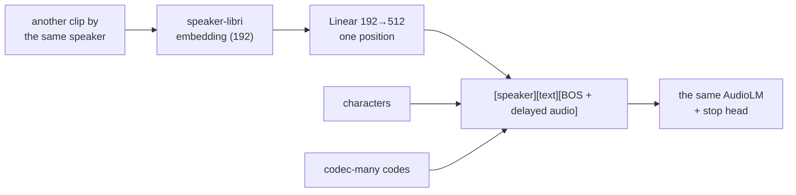

- **The voice comes from a reference clip, not a speaker id.** Each training row starts with a
  projection of the `speaker-libri` embedding of a *different* clip by the same speaker
  (`UtteranceDataset.reference`, never the clip itself). Using the clip's own embedding would
  hand the model that recording's room and words as well as its voice. Because the input is
  an embedding rather than an index, `speak --voice any.wav` can ask for a speaker it has
  never heard; whether that works is one of the things the report measures.
- **One codes directory over three corpora** (`encode-many`): LJSpeech plus LibriSpeech
  train-clean-100 and -360, 145,653 clips, with `transcripts.json`, `speakers.json` and one
  speaker embedding per clip (`speaker_emb.npy`) beside the codes. The clips are written in a
  **shuffled** order: every audio run holds out the manifest's *last* clips, and LibriSpeech
  is sorted by speaker, so in corpus order the held-out set would be one or two readers.
- **Encoded in batches of similar length** (10× faster than one clip at a time, which left
  the card 60% idle). Zero-padding changes only the last two frames of a clip's codes, the
  same two whatever the padding (measured on `codec-many`), which is trailing silence.
  `tests/test_multispeaker.py` checks every clip matches encoding it alone bar its edge.
- **Longer sentences.** LibriSpeech's run to 35 s. `max_frames: 768` (15.4 s) keeps 82% of
  clips, 372 hours; the rest are dropped, never cut. 30k steps, which on 16× LJ's data
  should stay clear of the overfitting the one-voice run hit at 22k.

```bash
python -m aksharallm.audio encode-many checkpoints/codec-many/ckpt_best.pt \
    --corpus data/audio/lj --corpus data/asr/train-clean-100 --corpus data/asr/train-clean-360 \
    --out data/audio/many-codes --speaker checkpoints/speaker-libri/ckpt_best.pt
scripts/audio.sh audiolm-many
python -m aksharallm.audio tts-report checkpoints/audiolm-many/ckpt_best.pt --duration own
python -m aksharallm.audio speak checkpoints/audiolm-many/ckpt_best.pt "Hello." --voice me.wav
python -m aksharallm.audio speak checkpoints/audiolm-many/ckpt_best.pt "Hello." --speaker-id 103
```

**What the report adds for a multi-speaker model** is a voice check: the speaker model's
cosine between each TTS sentence and its own speaker's original recording, against the
original of a sentence by a *different* speaker. If the conditioning works, "own" beats
"other" on most sentences, read as a paired count with a sign test. The codec row (codec vs
original) is the ceiling the codes allow, and the caveat above applies: compare these
cosines with each other, not with 1.

**Measured 2026-11-20** (`logs/queue/many.sh`, 00:35–02:13, 30k steps in 1 h 38 min). The
dataset kept 118,915 clips for training after dropping 26,306 longer than 15.4 s; 147 held
out, by many different speakers. Val fell at every eval and was still falling at the end
(5.62 at 1k → 4.01 at 20k → **3.928** at 29k), so unlike the one-voice run nothing was
memorised, and more steps would still help. The report, 40 held-out sentences by many
speakers, judged by `asr-libri460`:

| row | WER | CER |
|---|---|---|
| original recording | 8.2% | 1.5% |
| codec-many reconstruction | 9.2% | 1.9% |
| TTS, its own length (stop head) | **57.3%** | 36.2% |
| TTS, given the real length | 62.2% | 46.1% |

- **The voice is the headline.** The cosine to the TTS sentence's own speaker averaged
  **0.388**, to a different speaker 0.014, and the TTS was closer to its own speaker on **37
  of 40** sentences (sign test p 2e-8; 38/40 at the real length). For scale: two recordings by
  one speaker score 0.793 and the codec itself 0.488, so the TTS keeps most of what the codes
  can carry. A reference clip in front of the text is enough to choose the voice.
- **The words are about where the one-voice model was** (`audiolm-lj-stop`: 54.9% at its own
  length on LJ). These are harder sentences (many readers, up to 15 s), so the two numbers are
  not paired and only say "no worse". One runaway in 40.
- **Its own length did better than the real one** (57.3 vs 62.2%), unlike the one-voice
  model. The spoken length ran 1.08× the real one (median): a slightly slower reading is easier
  to transcribe. A direction from one run, not a finding.
- **The fox sentence**, heard by the recogniser:

  | voice | heard |
  |---|---|
  | `audiolm-lj-stop` (one voice, 2026-11-19) | the quick brown fox jumps ofe zy dos and noblty is surpriss |
  | `audiolm-many`, `--speaker-id LJ` | e quick brown fox jumps over the laze doll and nobody is surprised |
  | `audiolm-many`, `--voice` an unseen test-clean speaker (1089) | the quick brown fox jhumpsed over the lazye dogly surprised it |

  One sentence each, so listen rather than count: `logs/audio/speak/fox-many-*.wav`.
- **What next for it:** more steps (val was still falling), and an honest test of an unseen
  voice: the report's held-out sentences are by speakers it trained on, and the cosine on the
  1089 fox has not been measured against that speaker's own recordings.

### Cloning from a prompt, and voices it never heard (built 2026-11-20)

The report above holds out *sentences*, not *speakers*: every voice in it was also in
training. Two additions answer the harder question, and both need no new training.

- **Speakers it never heard.** `encode-many` of LibriSpeech **test-clean** (40 speakers, none
  in train-clean-100/360) with the same codec and speaker model gives
  `data/audio/many-unseen-codes`; `tts-report --codes DIR --val-clips 200` scores the TTS
  on it, each sentence in its own (new) speaker's voice. The same for the author's 80
  recorded takes (`data/audio/many-me-codes`, `encode-many --one-speaker me`, since two
  corpora of one voice would otherwise read as two speakers).
- **Cloning by continuation** (`speak --prompt clip.wav --prompt-text "what it says"`,
  `tts-report --prompt`). The model already speaks *continuations*: a training row is one
  utterance by one speaker. So a recording's codes are forced in as the first frames, its
  transcript goes in front of the new sentence (`speech.prompted_text`), and the model carries
  on in that voice. Only the frames after the prompt are returned. The report's prompt is the
  speaker's **shortest** other clip (at most 250 frames, 5 s), **whole**: a cropped clip's
  transcript would no longer say what its codes say. Sentences that do not fit beside their
  prompt in 768 frames are skipped and counted.

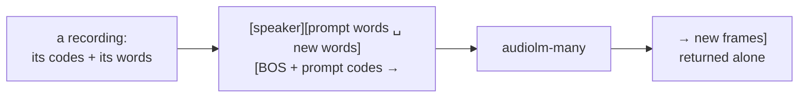

The control for cloning is `--prompt-items`: the **same** sentences and the **same**
reference clip's speaker embedding, with only the codes prompt left out. So a paired
comparison isolates exactly what the codes add. `tests/test_multispeaker.py` pins it: a model
that memorised two recordings of one sentence, by one voice, whose first halves differ, must
continue each prompt with its own second half. Only the prompt can tell them apart. The test
fails if the prompt is sampled rather than forced, or if the returned slice is off by one.

First try, on CPU, with the 30k model: speaker 1089 (unseen) prompted with one of his own
clips said the fox sentence as *"the quick brown fox shums over the lazy dibius surprised"*,
in his voice. The scored runs are queued below.

**And more steps.** `configs/audiolm-many-long.yaml` continues `audiolm-many` from a copy of
its checkpoint to 60k steps. The cosine is recomputed over 60k, so the learning rate jumps
from its 30k floor to about half the peak and then decays again; a loss bump is expected.
Its log starts at step 30,000.

**Measured 2026-11-20.** 40 sentences per row, own length, the asr-libri460 judge. "Voice
closer" is how many of the 40 come out closer (speaker cosine) to their own speaker than to a
different one. Embedding = the reference clip's speaker embedding only; cloned = the same
embedding plus that clip's codes as a prompt. Every pair is the same sentences and the same
reference.

| model, speakers | original / codec WER | TTS WER: embedding → cloned | voice closer | cosine to own voice: embedding → cloned (codec, same speaker) |
|---|---|---|---|---|
| 30k, seen | 9.8 / 10.4% | 52.0 → 56.8% (cloned better 14, worse 22, p 0.24) | 36 / 36 | 0.378 → 0.371 (0.496, 0.772) |
| 30k, **unseen** (test-clean) | 13.3 / 13.6% | 64.6 → 64.6% (19 / 15, p 0.61) | 30 / 30 | 0.169 → 0.219 (0.441, 0.616) |
| 60k, **unseen** | 13.3 / 13.6% | **45.1** → 59.4% (12 / 26, **p 0.03**) | 29 / 31 | 0.175 → **0.224** (27 / 13, **p 0.04**) |
| 30k, the author (8 sentences) | 68.5 / 81.8% | 55.8 → 88.7% (1 / 6) | – | 0.172 → 0.204 (0.248, 0.589) |

- **Voices it never heard work from the embedding alone**: 30 of 40 unseen speakers come out
  closer to themselves than to someone else, with no prompt. The speaker embedding
  generalises.
- **Cloning moves the voice a little and costs words.** On the 60k model the prompt pulls 27
  of 40 sentences closer to the speaker (p 0.04; cosine 0.175 → 0.224), and makes 26 of 40
  harder to transcribe (p 0.03). The 30k model showed neither effect clearly. Both TTS
  cosines are still far below the codec's 0.441 ceiling: the voice is recognisably *a* match,
  not a convincing copy.
- **The author's row cannot be judged.** The recogniser gets 68.5% WER on the author's own
  *original* recordings (its known blind spot; docs/23), so a TTS WER is meaningless there,
  and only 8 sentences had a usable prompt clip. Cosines rise slightly with the prompt
  (0.172 → 0.204) against a same-speaker 0.589. A judge that can hear this voice is needed
  first.
- **More steps paid**: `audiolm-many-long` val 3.928 → **3.816** (still falling at 60k).
  Seen, own length: WER 57.3 → **41.3%** (31 better, 8 worse, p 0.0003), voice closer 37 → 38;
  unseen with the embedding: 64.6 → 45.1% (27 / 8, p 0.002).

**Reading and comparing reports.** `audio tts-reports` lists every saved report on one line;
`audio tts-compare A B` pairs two of them per sentence (words and voice) and refuses two on
different sentences:

```bash
python -m aksharallm.audio tts-reports
python -m aksharallm.audio tts-compare \
    logs/audio/tts-audiolm-many-long-step59000-own-many-unseen-codes-promptitems.json \
    logs/audio/tts-audiolm-many-long-step59000-own-many-unseen-codes-prompt.json
```

**In the portal: the Audio tab's TTS panel.** Every report as a row (speakers, how the voice
was given, original / codec / TTS WER, voice cosine against its ceilings), a sentence-by-
sentence comparison of any two (a cloned report opens against its own control), each
sentence's original, codec and TTS clips to play, and **Speak**: type text and pick a voice
(LJ, or *clone* any sentence of the selected report, whose recording and words become the
prompt). Speak and a new TTS report run in the background as the printed `audio` command.

**Does codebook 0 carry the words? No more than before.** The content codebook's open
question, tested by `codec-transfer --judged 1,4,8`: the recogniser transcribes audio decoded
from codebook 0 *alone*, for both codecs, on the same clips.

| book 0 alone | LJ WER | other voices WER | other voices CER |
|---|---|---|---|
| `codec-many` | 26.8% | 42.4% | 20.3% |
| `codec-many-content` | 27.5% | 40.2% | 19.6% |

Paired per clip, content better / worse: LJ 27 / 24 (p 0.78), other voices WER 55 / 46
(p 0.43), CER 62 / 50 (p 0.30). With 4 or 8 books it is the same coin toss. So 100,000 steps of
content loss (cosine about 0.45 with the recogniser's states) did not move the words into the
first codebook in any way the recogniser can hear. **Idea closed for this size**: if it comes
back, it needs a much stronger weight or a different target (phones, not encoder states).

### The corpus that makes this measurable

`synth_corpus` writes **its own transcripts**, because we chose the vowel sequence and
therefore know it exactly. That is what makes TTS and ASR trainable and — more to the point
— *measurable*, with a real word error rate, before anyone has downloaded 2.6 GB. It is
source-filter synthesis: a pulse train at `f0` (the vocal folds) through three resonators at
the formant frequencies (the throat and mouth). Which vowel you hear is set entirely by
where F1 and F2 sit.

---

## What goes wrong

Seven traps, written down before building, and how each one landed:

1. **Codebook collapse is router collapse.** Same countermeasures as [MoE](15-moe.md): EMA
   updates, dead-code restart, the commitment term, per-codebook usage logged every step.
   *Hit immediately* — the first run collapsed to perplexity 1.0 by step 50, and the fix was
   **seeding the codebook from the first batch's encoder outputs** rather than from
   `randn·0.02`. A codebook whose scale does not match the encoder's is a codebook where one
   entry is nearest to everything.
2. **L2 on the waveform is nearly useless** — phase-sensitive. Multi-scale STFT instead, and
   the log term on *mel* bands (see above).
3. **The straight-through estimator.** Detach the wrong side and it trains smoothly and
   reconstructs noise. Pinned by a test that the gradient through the quantizer is exactly 1.
4. **The delay-pattern off-by-one.** Pinned by `undelay(delay(x)) == x`.
5. **Sample rate, channels and normalisation are asserted, not silently fixed.** `load_audio`
   records what it changed; `pack` refuses a corpus that mixes sample rates; the codec
   trainer refuses a corpus whose rate differs from its config.
6. **Audio tokens are a different vocabulary** — a separate checkpoint family. `load_codec`
   refuses a text checkpoint by name rather than failing on mismatched keys.
7. **TTS cannot be scored honestly by a number.** Handled above.

An eighth, found here: **the codebook must not run in bf16.** Under autocast the encoder
output is bf16, so the EMA ran in bf16 too — and bf16 has eight bits of mantissa, while an
EMA with decay 0.99 adds one percent of a centroid per step. One percent is below the
dtype's own resolution, so the codebook would have quietly stopped moving. The quantizer now
forces float32 internally and casts the straight-through output back, so the decoder keeps
its fast dtype.

---

## What it buys

The bitrate ladder, **audible in a browser**:

```bash
.venv/bin/python -m aksharallm.audio reconstruct checkpoints/codec-synth/ckpt_best.pt \
    data/audio/synth/wavs/synth-0399.wav --codebooks 1,2,4,8
```

Four files plus the original. The trade becomes something you hear rather than something you
read — and it is the same trade [quantization](11-quantization.md) makes silently in the
weights.

## The code, in reading order

Read [doc 4](04-model.md) and [doc 5](05-pretraining.md) first if you have not: parts 3 and 4
are that chapter's model, unchanged, over different integers.

| # | file | what to look for |
|---|---|---|
| 1 | [`audio/io.py`](../aksharallm/audio/io.py) | `read_wav` (8-bit WAV is *unsigned*), then `resample` — the phase table, and why the residue is the index |
| 2 | [`audio/features.py`](../aksharallm/audio/features.py) | `stft`/`istft` and the COLA argument; `mel_filterbank`'s unit-area normalisation; `griffin_lim`'s `momentum/(1+momentum)` |
| 3 | [`audio/dataset.py`](../aksharallm/audio/dataset.py) | `pack` and the assertion rule, then the clip-boundary rule in `AudioDataset`. `synth_corpus` last — it is a voice, written out |
| 4 | [`audio/vq.py`](../aksharallm/audio/vq.py) | `VectorQuantizer.forward` (the float32 line, the straight-through line), then `_seed` and `_update`'s restart. Then `ResidualVQ` — six lines that make bitrate a dial |
| 5 | [`audio/codec.py`](../aksharallm/audio/codec.py) | `Snake`, `Down`/`Up`'s asymmetric padding, then `ReconstructionLoss` — the two terms and what each fixes |
| 6 | [`audio/config.py`](../aksharallm/audio/config.py) · [`configs/codec-synth.yaml`](../configs/codec-synth.yaml) | diff it against [`codec-lj.yaml`](../configs/codec-lj.yaml); that diff is what scaling to real speech costs. Then [`codec-many.yaml`](../configs/codec-many.yaml): `data.sources` and `train.init`, and `MixedAudioDataset` in `dataset.py` |
| 7 | [`audio/train_codec.py`](../aksharallm/audio/train_codec.py) | the module docstring's "what to watch, in order of how badly it goes wrong". Then the shared STOP/pid/jsonl contract, then `evaluate_sources` (one val number per corpus) and `warm_start` (which config fields may differ) |
| 8 | [`audio/measure.py`](../aksharallm/audio/measure.py) | the table at the top — what each metric cannot see — then `cepstrum`'s relative floor |
| 9 | [`audio/delay.py`](../aksharallm/audio/delay.py) | the ASCII diagram, then `delay` and `undelay`. Twelve lines, and trap 4 |
| 10 | [`audio/lm.py`](../aksharallm/audio/lm.py) | `AudioLM.__init__` (why the body's own head is unused, and the optional one-logit `stop_head`), then `training_pair` — the BOS column generation starts from — and `forward`'s shift, which happens on the *delayed* sequence, which is the whole trick |
| 11 | [`audio/text.py`](../aksharallm/audio/text.py) · [`audio/speech.py`](../aksharallm/audio/speech.py) | why character level; then `utterance_loss`, where TTS and ASR are one flag apart and each row is laid out the way `speak`/`transcribe` lay it out; then `tts_ladder`, the three-row score |
| 11b | [`audio/content.py`](../aksharallm/audio/content.py) | `teacher_states` (the recogniser's `encode(hidden=True)`, resampled to 50 frames/s), then `content_loss`. `ResidualVQ.forward(first=True)` is where codebook 0's own vector comes from |
| 12 | [`audio/transfer.py`](../aksharallm/audio/transfer.py) | `measure_corpus`, then `paired`: every clip is read against its own original, so "the codec hurts these voices" is never confused with "these sentences are harder". Then `voice_columns`, the identity score and its two references |
| 12b | [`audio/speaker.py`](../aksharallm/audio/speaker.py) · [`audio/train_speaker.py`](../aksharallm/audio/train_speaker.py) | `SpeakerEncoder.forward` (mean + std pooling), `AMSoftmax`'s margin, `SpeakerCorpus`'s per-speaker hold-out, then `eer`. The trainer chooses its best checkpoint on *unseen* speakers. Break `eer` on purpose in [lesson 24](lessons/24-speaker.md) |
| 13 | [`aksharallm/audio/__main__.py`](../aksharallm/audio/__main__.py) · [`portal/audio.py`](../aksharallm/portal/audio.py) | the two front ends, over one set of functions |
| 14 | [`audio/ttsreports.py`](../aksharallm/audio/ttsreports.py) · [`portal/tts.py`](../aksharallm/portal/tts.py) | `compare`: two TTS reports paired per sentence (fewer word errors, closer voice), refusing different sentences; `finite`, because a one-speaker report's NaN emptied the browser panel. Then the Audio tab's TTS panel and its Speak / report jobs |

What pins it: [`tests/test_audio.py`](../tests/test_audio.py) and
[`tests/test_codec.py`](../tests/test_codec.py) — including the three regressions above
(bf16 codebooks, `spectral_convergence`'s argument order, MCD's absolute floor), the exact
`undelay(delay(x))` round trip, and that a stage with an **odd** stride downsamples by
exactly that stride.
