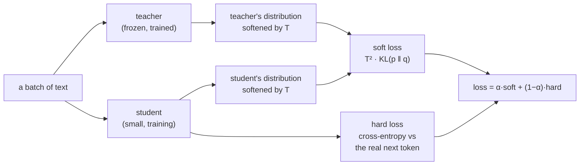
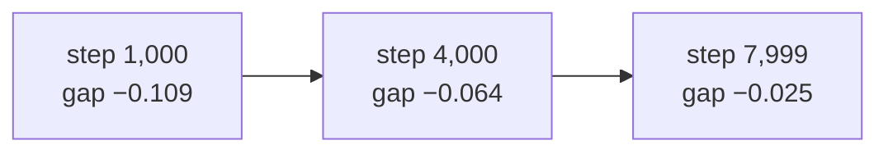
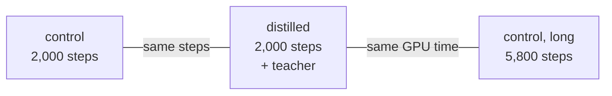

# 24. Distillation: a small model taught by a big one

> [Doc 11](11-quantization.md) made a trained model smaller by storing its weights in fewer
> bits. This chapter makes a *different*, smaller model: one with fewer weights, trained to
> imitate the big one. The big model is the **teacher** and the small one is the
> **student**. The student learns from the teacher's whole prediction at every position, not
> just from the one token that actually came next.



## Why a distribution teaches more than a label

Ordinary pretraining ([doc 5](05-pretraining.md)) shows the model one right answer per
position: after "The capital of France is", the next token was " Paris", and every other
token is equally wrong. A trained model knows more than that. It puts, say, 0.6 on " Paris",
0.1 on " a", 0.05 on " the" and almost nothing on " banana". That spread says which wrong
answers are *nearly* right, which is something a single label cannot say.

Distillation hands the student that spread. Two things make it work:

- **A temperature `T`.** Both distributions are computed from `logits / T`. At `T = 1` the
  teacher's tail is tiny, so the student barely sees it. At `T = 2` or `4` it flattens out,
  and the small probabilities carry real weight. This repo uses `T = 2`.
- **A factor of `T²` on the soft loss.** Softening also shrinks the soft loss's gradient,
  by `1/T²`. Without the factor, raising the temperature would quietly turn the soft term
  down, and `α` would stop meaning what it says. `tests/test_distil.py` checks that the
  gradient's size at `T = 4` stays within 4x of its size at `T = 1`. Without the factor it
  would be about 16x smaller.

The hard term stays, weighted `1 − α`, because the teacher is wrong sometimes and the real
text is not. This repo uses `α = 0.5`. With `α = 0` the loss is exactly ordinary
pretraining, which is how the experiment's control run is defined.

## Why only between our own models

The soft loss compares the teacher's probability for token id *n* with the student's
probability for the same id. That only means something if **id *n* is the same string to
both models**, so they must share one tokenizer ([gotcha 3](../AGENTS.md)). No Ollama model
uses our tokenizer, which is why "learn from a 31B model" is done through generated data
instead ([doc 14](14-synthetic-data.md)). Distillation here is from our 300M to a smaller
model, or from `tiny` to a smaller one.

A mismatch does not crash. The loss falls, the curve looks normal, and the student learns
nonsense. So the check is a refusal, not a warning, and it compares the **tokenizer files
themselves**. Comparing paths would reject the same file copied elsewhere. Comparing
vocabulary sizes would accept two different 8,192-token vocabularies. A test plants exactly
that second case.

The teacher also must not be a diffusion model or a tagger (their outputs are not next-token
distributions), and must have a context window at least as long as the student trains on.

## The logits are the memory

At the 300M scale a batch of `(8, 1024)` positions over a 32,768-token vocabulary gives a
logit tensor of 268M numbers: 0.5 GB in bf16, 1 GB in fp32. The KL needs the student's
softmax, the teacher's, and their logs, all in fp32, because it subtracts two
log-probabilities that are often nearly equal and bf16 loses that difference.

So the loss is computed `distil.chunk` positions at a time (128 by default). Chunking alone
saves nothing: autograd keeps every chunk's intermediates for backward. Each chunk therefore
runs under `torch.utils.checkpoint`, and backward recomputes it, so only one chunk's fp32
work is ever alive. A test checks that the chunked loss and every gradient equal the
one-piece computation, with a ragged last chunk and ignored positions in it.

The teacher's weights are the smaller problem. They can be loaded **quantized with our own
code** ([doc 11](11-quantization.md)): `distil.teacher_quant: nf4` holds a 300M teacher in
about 0.2 GB instead of 0.6. That also makes a question this repo is well placed to answer:
does a 4-bit teacher teach worse?

## It is an objective, not a trainer

There is no separate training loop. [Doc 5](05-pretraining.md) says how a new kind of
training arrives: as a new *objective* that the one loop runs. `DistilObjective` is the
fourth, after next-token prediction, masked diffusion ([doc 20](20-diffusion.md)) and the
punctuation tagger ([doc 23](23-speech-recognition.md)). A config with a `distil.teacher`
gets it; nothing else changes. Accumulation, the schedule, mixed precision, resume, the stop
file, the session log, the run report and the portal's Start and Stop buttons all work
unchanged.

The teacher is loaded on the first batch, not at startup, because only then is the device
known. Under multi-GPU that is a different card on every rank. It is frozen and in eval
mode, and a test checks its weights are unchanged after a run.

## The experiment: does a teacher help?

A controlled pair at the TinyStories scale, the same shape as the MoE experiment
([doc 15](15-moe.md)):

| run | config | student | teacher |
|---|---|---|---|
| control | `configs/tiny-student.yaml` | ~5.3M (d 256, 4 layers) | none |
| distilled | `configs/tiny-distil.yaml` | the same | `tiny` (13.8M, val 1.472) |

Everything else is identical: data, seed (and therefore the batches, gotcha 16), schedule,
8,000 steps. Both report the student's **plain cross-entropy** as their validation number,
the same number an ordinary run reports, so the two val curves go on one axis. The gap
between them is what the teacher bought.

```bash
scripts/experiment.sh tiny-student      # the control
scripts/experiment.sh tiny-distil       # the same student, taught by tiny
```

Or press **Start** on either run in the portal's dashboard. Its Configuration panel shows
the teacher, temperature and α for the distilled run.

### Measured (2026-11-01, on the 3090)

| | control (`tiny-student`) | distilled (`tiny-distil`) | teacher (`tiny`) |
|---|---|---|---|
| parameters | 5.3M | 5.3M | 13.8M |
| final val loss | 1.6595 | **1.6341** | 1.4722 |
| perplexity | 5.26 | **5.13** | 4.36 |
| throughput | 974k tok/s | 213k tok/s | |
| wall clock, 8,000 steps | 7 min | 31 min | |

The val gap at every evaluation (distilled minus control):

| step | 500 | 1,000 | 2,000 | 3,000 | 4,000 | 5,000 | 6,000 | 7,000 | 7,999 |
|---|---|---|---|---|---|---|---|---|---|
| gap | −0.071 | **−0.109** | −0.100 | −0.077 | −0.064 | −0.050 | −0.038 | −0.031 | **−0.025** |



- **The teacher helped, and the student ended 1.5% better.** On the same data, seed and
  steps, the distilled student's val loss is 0.025 lower. That is about 14% of the way from
  the control to the teacher (0.025 of 0.187).
- **Most of the help came early, and it shrinks.** The gap was largest at step 1,000 and
  fell at every evaluation after it. The teacher's distribution is most useful while the
  student knows little; as the student converges on the same data, the hard labels catch up.
  The run ends before the gap does, so a longer run would probably narrow it further.
- **It cost 4.6× the wall clock.** Each batch also runs the 13.8M teacher (2.6× the
  student's size) and two fp32 softmaxes over 8,192 tokens, recomputed in backward. The same
  31 minutes would train the control for about 37,000 steps instead of 8,000. So at *equal
  compute*, rather than equal steps, this experiment does not show distillation winning, and
  it was not designed to test that.
- **The knowledge suites can't see it:** ARC-Easy 26.6 vs 25.4%, PIQA 51.0 vs 52.6%, all
  within about one standard error of chance at 5M parameters.

**Reading.** Distillation makes a small model better per training step, most of all early
on. When steps are cheap and the data is plentiful, as with a 5M student on TinyStories,
more steps of plain training can buy the same thing. The case for it gets stronger at the
300M scale, where steps are expensive and the student will see far fewer tokens than it
could use. That is the experiment worth running next, with a matched-compute control.

### Reading a run

The step line carries both halves: `| kd 1.234 | ce 2.345`.

- **`ce` is the number to compare with the control's training loss.** It is the hard term
  alone, which is exactly what an ordinary run calls its loss.
- **`loss` (and its `ppl`) is the mix**, so it sits on a different scale from the control's.
  Do not put the two training-loss curves on one chart. The val curves are the comparison.
- **`kd` should fall quickly and then flatten.** It cannot reach zero: the student is too
  small to copy the teacher exactly, and that gap is the cost of the smaller model.
- **Throughput and MFU count the student only.** Every batch also costs a teacher forward
  pass, so tokens per second are lower than the control's for the same student.

## The real one: 300M into ~100M, with a third arm

The TinyStories pair left one question open: was the teacher worth its cost? So the 300M
version has **three arms**, all the same ~101M student (d 768, 12 layers) on the teacher's own
85/15 blend, the same seed and the same val split:

| arm | config | steps | teacher | asks |
|---|---|---|---|---|
| control | `configs/small-student.yaml` | 2,000 | none | |
| distilled | `configs/small-distil.yaml` | 2,000 | `small-code` (300M, val 2.548) | does the teacher help, step for step? |
| matched compute | `configs/small-student-long.yaml` | 5,800 | none | is it worth its cost, hour for hour? |



The third arm's step count comes from a measurement, not a guess. On the 3090 the student
alone runs **3.5 s/step** (70k tok/s, 10.2 GB); distilled it runs **10.2 s/step** (24k tok/s,
12.5 GB) with the teacher compiled. That is 2.9×, so 5,800 steps of plain training cost the
same GPU time as 2,000 distilled ones. Compiling the teacher saved only 8% (11.1 → 10.2 s);
most of the remaining cost is the two fp32 softmaxes over a 32,768-token vocabulary.

2,000 steps is about 490M tokens, roughly 5 per parameter: undertrained on purpose, because
the TinyStories pair showed the teacher helps most early. The three arms run in night windows
(`logs/queue/distil-nights.sh`, about three nights), then each is scored with `eval domains`
on the blend (prose and Python separately) and the fast suite. Each also has a Start button
in the portal.

**Not run yet.** The result belongs here.

## After that

1. **SFT on the student**, if it is worth keeping. This order was agreed on 2026-08-01:
   distil the base first, because the base is what the quantized 300M is compared against.
2. **Distilled ~100M vs `gptq-nf4-g64` of the 300M at a matched ~205 MB** (doc 11). Two ways
   to make the same model small, compared at the same file size.
3. **A 4-bit teacher vs a bf16 teacher** for the same student (`teacher_quant: nf4`).

Not built: initialising the student from the teacher's layers (worth testing against from
scratch), and an MoE student (refused, because its load-balancing loss lives on a path this
objective does not take, and a router without it can collapse unseen).

---

## The code, in reading order

One new file and four places that had to notice it.

| # | file | what to look for |
|---|---|---|
| 1 | [`configs/tiny-distil.yaml`](../configs/tiny-distil.yaml) | diff it against `configs/tiny-student.yaml`: the `distil:` block is the whole experiment |
| 2 | [`train/distil.py`](../aksharallm/train/distil.py) → `distil_loss` and `_chunk_losses` | the two terms, the `T²`, the fp32 cast, the mask on ignored positions, and `checkpoint` around each chunk |
| 3 | same file → `check_teacher` | the refusals: vocabulary, tokenizer *contents*, a non-next-token teacher, a shorter window |
| 4 | same file → `load_teacher` and `DistilObjective` | frozen, eval mode, optional `int8`/`nf4` through `quant/convert.py`; loaded at the first batch; the `kd`/`ce` stats |
| 5 | [`aksharallm/config.py`](../aksharallm/config.py) → `DistilConfig` | `teacher`, `temperature`, `alpha`, `teacher_quant`, `chunk` |
| 6 | [`train/pretrain.py`](../aksharallm/train/pretrain.py) → `objective_for` | the one branch that picks this objective when `distil.teacher` is set |
| 7 | [`portal/runs.py`](../aksharallm/portal/runs.py) | the `LAUNCHERS` entries for both experiments, and the `teacher` row in `_config_summary` |

What pins it: `tests/test_distil.py`, 19 tests. They cover the loss against the KL written
out by hand, chunked equal to unchunked, the `T²` scale, ignored positions dropping out of
both terms, every refusal, a frozen teacher in float/int8/nf4, and one real run through
`pretrain.main`. Every test that guards a mutation was seen to fail against it first, and
one gap was found that way: no test covered the soft term ignoring masked positions, so one
was added. Break the `T²` on purpose in [lesson 22](lessons/22-distillation.md).
