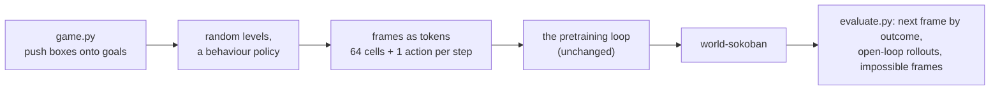
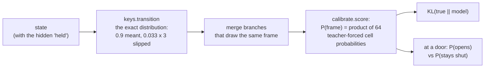
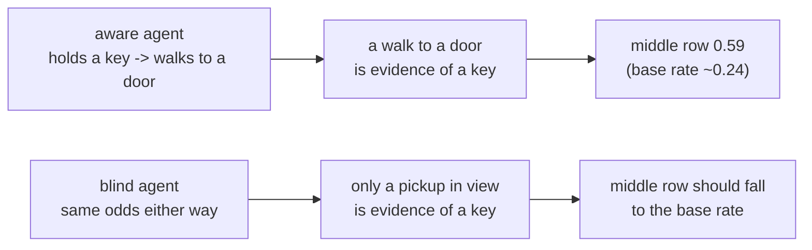

# 25. A world model: the transformer predicting what a game does next

> A language model predicts the next token of text. A **world model** predicts the next
> state of a world, given what just happened and what someone did. That is the idea behind
> the learned game engines and robot simulators of 2025–26. This chapter builds the smallest
> honest version: a game we wrote, so every prediction can be checked exactly, and the same
> transformer and training loop as [doc 5](05-pretraining.md), unchanged.



## The game

An 8×8 grid with a border of walls, a few interior walls, one to three boxes, as many goals,
and the agent. Five actions: `up`, `down`, `left`, `right`, `stay`. The rules are Sokoban's:

| the agent moves into | what happens | outcome |
|---|---|---|
| floor or a goal | it moves | `moved` |
| a box, with floor or a goal behind it | the box moves one cell on, the agent follows | `pushed` |
| a wall, or a box with a wall or another box behind it | nothing | `blocked` |
| (`stay`) | nothing | `stayed` |

Every level is random, so a model cannot memorise layouts. It has to learn the rule. The
rules are deterministic, so the next frame is a *function* of the last frame and the action,
and a perfect score is possible. Any error is the model's.

## Frames as tokens

```
<|endoftext|>  # # # # # # # # # . . . . . . # ... (64 cells)  right  # # # ... (64)  up ...
```

**No codec is needed.** A frame is already 64 symbols from an alphabet of seven (`# . @ $ o *
+`), so each cell *is* a token. [Vision](22-vision.md) needed patches and [audio](21-audio.md)
needed a learned codec only because pixels and samples are not small alphabets. The
vocabulary is 15 words: three specials, seven cells, five actions. `world/data.py` saves it
as a real `tokenizers` WordLevel model, so `Tokenizer`, the trainer's vocab check and the
checkpoint all work unchanged.

**The data's policy is built for coverage, not to win.** Random moves alone give few pushes
(4.5%), because a push needs the agent lined up behind a box. Pushing whenever a box is
adjacent gave too many *blocked* pushes (52% blocked), because boxes jam against walls. The
policy that ships pushes only where the box can move (70% of the time when it can), and
moves at random otherwise: 58% moved, 8% pushed, 29% blocked, 5% stayed over 60,000
episodes of 30 steps, 121M tokens.

## How it is scored

The loss falls fast and says little: most cells never change, so a model that copies the
last frame already predicts most tokens. The evaluation therefore leads with **whole frames**
and compares each number with what copying would score.

- **Next frame, exact.** Given 5 steps of history and the action, are all 64 predicted cells
  right? This needs no sampling. Under teacher forcing the argmax at each cell is what greedy
  decoding would write *as long as every earlier cell was right*, and a frame is exact only
  if every cell is. So "all 64 teacher-forced argmaxes correct" is exactly "greedy decoding
  writes this frame". One forward pass replaces 64.
- **By outcome.** Copying the last frame scores 100% on `blocked` and `stayed` and 0% on
  `moved` and `pushed`. A model that learned only to copy looks about 35% right overall and
  is useless. The table shows each outcome beside its copy baseline.
- **Rollouts.** From one real frame, the model plays 10 actions with its *own* predictions
  fed back. One wrong cell stays in the context and can compound. Scored as exact frames by
  step, plus **impossible frames**: frames no game could produce (two agents, none, a hole in
  the border), found by `game.parse`. This is the world-model version of a hallucination.

The scorer is tested against a model whose answers are known: one that copies the previous
frame. It must score exactly 100% on `blocked`/`stayed` and 0% on `moved`/`pushed`, so a
slice that is one token off fails the test (`tests/test_world.py`).

```bash
python -m aksharallm.world prepare                 # ~1 min on the CPU, 242 MB
scripts/experiment.sh world-sokoban                # ~10 min on a 3090
python -m aksharallm.world eval checkpoints/world-sokoban/ckpt_best.pt
python -m aksharallm.world play checkpoints/world-sokoban/ckpt_best.pt   # one rollout, side by side
python -m aksharallm.world results                 # every saved evaluation, one line each
```

**In the portal: the World tab** (☰ Menu → Reach further → World). It leads with the score
table by outcome, each row beside its copy-the-last-frame column, and the rollout as bars
(exact frames, impossible frames). **Watch it play** runs one game open loop (the same
`play` function the CLI prints, `--json` gives its frames) and draws the true frame beside
the model's, with every wrong cell outlined. **Run it from here** starts `world prepare` and
`world eval` in the background and prints each command; training is the dashboard's Start
on `world-sokoban`.

## Measured

**2026-11-20, 4,000 steps, 6 minutes on the 3090: the toy is solved.**

| | n | exact frame | cells | copying would score |
|---|---|---|---|---|
| `blocked` | 1,564 | 100.0% | 100.00% | 100% |
| `moved` | 2,819 | 100.0% | 100.00% | 0% |
| `pushed` | 368 | 100.0% | 100.00% | 0% |
| `stayed` | 249 | 100.0% | 100.00% | 100% |
| all | 5,000 | **100.0%** | 100.00% | 36.3% |

Rollouts of 10 actions with its own frames fed back: 100% exact at every step, 0 impossible
frames. Val loss is 0.094 at step 500 and 0.087 at the end. It is not zero because the next *action*
is the random policy's choice and the first frame of an episode is a random level, and no
model can predict either.

So the 13.8M shape learned Sokoban's rules exactly, pushes included, on levels it had never
seen. That is a result about how easy this world is, not about how good the model is: an 8×8
grid with deterministic rules is a function a small transformer can represent outright. So
the next world is one it cannot solve completely.

## The harder world: a key you cannot see, a floor that slips

`world/keys.py` keeps everything above and adds two things, each chosen so the right answer
is still known exactly:

| new | rule | what it tests |
|---|---|---|
| key `k` | walk onto it: it vanishes, and the agent carries it. **Carrying is never drawn.** | memory |
| door `D` | walk into it with a key: it opens and the key is spent (`unlocked`). Without one: nothing (`locked`) | memory |
| slip | one move in ten goes in one of the other three directions. The action token is what was *meant* | uncertainty |

Levels have 0–2 keys (none in a fifth of them) and 1–2 doors, so a frame with no key in it
does not say whether one is being carried. **Whether the next door opens depends on
something the frame does not show**; the only way to know is to have seen the pickup, which
has to be in the context the model can read. And with slips, the same frame and action can
be followed by up to four different frames, so "exact" stops being the right question.



`keys.transition` returns the world's distribution over next states exactly, and the model
gives one too: the probability of a frame is the product of its 64 teacher-forced cell
probabilities, so every candidate frame is scored in one forward pass. `world/calibrate.py`
reports, per intended move:

- **Most likely frame.** Is the model's greedy frame the world's most likely one? Same
  teacher-forcing argument as before, beside the copy column.
- **KL(true ‖ model)**, in nats per frame. 0 means the model's probabilities are the
  world's. The probability the model puts on frames the game cannot produce is part of it,
  and is also shown on its own.
- **Belief at a door.** At every move into a door, two counterfactual frames are scored
  whatever actually happened: the door opening and the door staying shut.
  `P(open) / (P(open) + P(shut))` is the model's belief that the agent holds a key. The
  truth is 1 or 0, split three ways, and the split is the whole test:

  | at a door, the agent… | what a model can know |
  |---|---|
  | holds a key it was **seen** picking up, inside the context | everything: should be ~1 |
  | holds a key picked up **before** the context | nothing from the window: the base rate is the best possible |
  | holds no key | should be ~0, unless a key vanished in view and was not spent |

  A model that reads only the last frame scores the same in all three rows.

Rollouts are scored against the game with **no slips**, the single most likely game for those
actions, so "exact by step" still means something.

The scorer is tested against models whose answers are known. A uniform model gives every
frame 17⁻⁶⁴, so its KL must be `64 log 17 − H(true)` for each transition exactly. A model
certain that nothing changes must believe every door stays shut: right on every
"not held" door, wrong on every held one, and its most-likely-frame score equal to the copy
column. A property test checks that "seen in context" means exactly "the context shows a key
vanishing" (only a pickup removes one). Five mutants were checked red: the context
boundary, the KL sign, the door belief inverted, the wrong mode, and merged branches losing mass.

```bash
python -m aksharallm.world prepare --game keys     # data/world-keys, ~1 min on the CPU
scripts/experiment.sh world-keys                   # world-sokoban's model and budget
python -m aksharallm.world eval checkpoints/world-keys/ckpt_best.pt --episodes 600
python -m aksharallm.world play checkpoints/world-keys/ckpt_best.pt
```

The World tab draws a keys result as two tables: by move (most likely frame, copy, KL,
P(most likely) for the world and for the model) and the door split.

### Measured 2026-11-21: `world-keys`

Same model and budget as `world-sokoban` (4,000 steps, 6 minutes on the card), scored over
600 episodes, 15,000 transitions:

| | most likely frame | copying the last frame | KL nats/frame | mass on impossible frames |
|---|---|---|---|---|
| all moves | **99.0%** | 25.6% | **0.021** | 1.19% |

| intended move ended… | n | most likely frame | KL | P(most likely): world | model |
|---|---|---|---|---|---|
| moved | 10,158 | 100% | 0.003 | 0.900 | 0.901 |
| blocked | 2,403 | 100% | 0.003 | 0.922 | 0.920 |
| stayed | 783 | 100% | 0.001 | 1.000 | 0.999 |
| took key | 422 | 100% | 0.005 | 0.900 | 0.908 |
| pushed | 198 | 100% | 0.044 | 0.900 | 0.900 |
| **locked** | 657 | **86.8%** | **0.247** | 0.924 | 0.750 |
| **unlocked** | 379 | **83.1%** | **0.290** | 0.900 | 0.709 |

**The slips are learned, almost exactly.** Wherever the frame says everything (moves, walls,
pushes, pickups), the model puts 0.90 on the intended move and spreads the rest over the
slips the way the world does; KL is a few thousandths of a nat. Both of the misses are at
doors, where the answer depends on the hidden key:

| at a door, the agent… | n | belief it opens | truth | right |
|---|---|---|---|---|
| holds a key it was seen picking up | 176 | **0.951** | 1 | 98.3% |
| holds a key picked up before the context | 203 | 0.591 | 1 | 70.4% |
| holds no key | 657 | 0.187 | 0 | 87.1% |

The top row is memory working: a pickup up to ~30 moves back in the context is used. The
middle row should be the base rate if the window were the only evidence, and it is well
above it (about 0.24 of doors without a pickup in view are held ones). The likeliest source
is the agent, not the frames: `keys.policy` heads for a door 60% of the time when it holds
a key, so *walking to a door* is itself evidence of a key. That is a real inference from
behaviour, and a leak in the test. A policy that ignores `held` would remove it; this is a
hypothesis, not checked.

Rollouts (own frames fed back, scored against the no-slip game): 100, 100, then 96% exact
from step 3 to step 10, with 0 impossible frames.

So the keys world is not solved the way Sokoban was: the model is calibrated where the
frame is enough and uncertain exactly where it is not. The next version of the test is the
same game with a `held`-blind policy, so that only memory can answer the middle row.

### The leak, and the run without it (built 2026-11-21, queued)

`keys.policy_blind` is the same coverage policy choosing only from what the frame shows: it
heads for a door 35% of the time, a visible key 25%, a box 12%, whatever the agent carries.
A test holds it to that: for 400 random states, the same random draws with and without a key
in hand must give the same move (and the aware policy must not, or the test proves nothing).



The scorer now prints the **base rate** beside the door table: of the doors with no pickup
in view, the share where a key is held anyway. A model that reads only its window can believe
no more than that on the middle row. Two runs answer the question:

| run | trained on | scored on | what it says |
|---|---|---|---|
| `world-keys` again, `--policy blind` | the aware agent | the blind agent | whether its 0.59 was read from the agent's walk: if so, it falls when the walk stops meaning anything |
| `world-keys-blind` | the blind agent | the blind agent | memory alone: the top row should stay high, the middle row should sit at the base rate |

The blind agent opens fewer doors (1.3% of moves against 2.2%) and finds more locked ones
(10.6% against 4.0%), because it walks into doors without a key. Score it on 1,000 episodes
rather than 600 so the "seen in context" row is not thin.

```bash
python -m aksharallm.world prepare --game keys --policy blind     # data/world-keys-blind
scripts/experiment.sh world-keys-blind                            # same model and budget
python -m aksharallm.world eval checkpoints/world-keys-blind/ckpt_best.pt --episodes 1000
python -m aksharallm.world eval checkpoints/world-keys/ckpt_best.pt --episodes 1000 --policy blind
```

A checkpoint is scored on the agent it trained on unless `--policy` says otherwise (read from
its data's `meta.json`), and a cross-scored file is named `<run>-step<N>-on-<policy>.json` so
it never overwrites the run's own. The World tab has the blind agent in its Game picker and a
"score on" choice beside Evaluate.

## The code, in reading order

| # | file | what to look for |
|---|---|---|
| 1 | [`world/game.py`](../aksharallm/world/game.py) → `step` | the whole rule set in fifteen lines, and the four outcomes |
| 2 | same file → `random_level`, `policy`, `render`, `parse` | random layouts; the coverage policy; frame ↔ 64 symbols; what makes a frame impossible |
| 3 | [`world/data.py`](../aksharallm/world/data.py) → `write_tokenizer`, `episode_tokens`, `prepare` | the 15-word tokenizer, the frame-action-frame layout, separate seeds for train and val |
| 4 | [`configs/world-sokoban.yaml`](../configs/world-sokoban.yaml) | tiny's shape with `vocab_size: 15`; nothing else about the trainer changes |
| 5 | [`world/evaluate.py`](../aksharallm/world/evaluate.py) → `next_frame` | why teacher-forced argmax equals greedy for an exact frame, and the copy baseline per outcome |
| 6 | same file → `rollout` | the model's own frames fed back, and `parse` counting impossible ones |
| 7 | [`world/__main__.py`](../aksharallm/world/__main__.py) | `prepare`, `eval` (writes `logs/world/<run>-step<N>.json`), `play`, `results` |
| 7b | [`world/keys.py`](../aksharallm/world/keys.py) → `apply`, `transition` | the harder world: keys, doors, the hidden `held`, and the exact distribution with slips |
| 7b′ | same file → `policy`, `policy_blind` | the leak: the aware agent's walk gives the key away; the blind one chooses from the frame alone |
| 7c | [`world/calibrate.py`](../aksharallm/world/calibrate.py) → `transitions`, `score` | merged candidate frames, KL from the world, the door belief split by where the pickup was, and `base_rate`: what a belief from the window alone can reach |
| 8 | [`portal/world.py`](../aksharallm/portal/world.py) · [`static/js/world.js`](../aksharallm/portal/static/js/world.js) | the World tab: results, `play` inline, the two jobs through `portal/jobs.py`. World models are found by their vocabulary (15 words sokoban, 17 keys), not by name |

Tests: `tests/test_world.py`. They cover the push and block rules, the render/parse round
trip, the token layout and tokenizer, and the scorer against the copying model. Four
mutants were checked red, including a one-token slice error and a box pushed through a box.
`tests/test_portal_newtabs.py` pins the playout's wrong-cell count against the copying
model.
