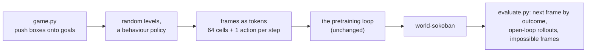

# 25. A world model: the transformer predicting what a game does next

> A language model predicts the next token of text. A **world model** predicts the next
> state of a world, given what just happened and what someone did. That is the idea behind
> the learned game engines and robot simulators of 2025–26. This chapter builds the smallest
> honest version: a game we wrote, so every prediction can be checked exactly, and the same
> transformer and training loop as [doc 5](05-pretraining.md), unchanged.



## The game

An 8×8 grid with a border of walls, a few interior walls, one to three boxes, as many goals,
and the agent. Five actions: `up`, `down`, `left`, `right`, `stay`. The rules are Sokoban's:

| the agent moves into | what happens | outcome |
|---|---|---|
| floor or a goal | it moves | `moved` |
| a box, with floor or a goal behind it | the box moves one cell on, the agent follows | `pushed` |
| a wall, or a box with a wall or another box behind it | nothing | `blocked` |
| (`stay`) | nothing | `stayed` |

Every level is random, so a model cannot memorise layouts. It has to learn the rule. The
rules are deterministic, so the next frame is a *function* of the last frame and the action,
and a perfect score is possible. Any error is the model's.

## Frames as tokens

```
<|endoftext|>  # # # # # # # # # . . . . . . # ... (64 cells)  right  # # # ... (64)  up ...
```

**No codec is needed.** A frame is already 64 symbols from an alphabet of seven (`# . @ $ o *
+`), so each cell *is* a token. [Vision](22-vision.md) needed patches and [audio](21-audio.md)
needed a learned codec only because pixels and samples are not small alphabets. The
vocabulary is 15 words: three specials, seven cells, five actions. `world/data.py` saves it
as a real `tokenizers` WordLevel model, so `Tokenizer`, the trainer's vocab check and the
checkpoint all work unchanged.

**The data's policy is built for coverage, not to win.** Random moves alone give few pushes
(4.5%), because a push needs the agent lined up behind a box. Pushing whenever a box is
adjacent gave too many *blocked* pushes (52% blocked), because boxes jam against walls. The
policy that ships pushes only where the box can move (70% of the time when it can), and
moves at random otherwise: 58% moved, 8% pushed, 29% blocked, 5% stayed over 60,000
episodes of 30 steps, 121M tokens.

## How it is scored

The loss falls fast and says little: most cells never change, so a model that copies the
last frame already predicts most tokens. The evaluation therefore leads with **whole frames**
and compares each number with what copying would score.

- **Next frame, exact.** Given 5 steps of history and the action, are all 64 predicted cells
  right? This needs no sampling. Under teacher forcing the argmax at each cell is what greedy
  decoding would write *as long as every earlier cell was right*, and a frame is exact only
  if every cell is. So "all 64 teacher-forced argmaxes correct" is exactly "greedy decoding
  writes this frame". One forward pass replaces 64.
- **By outcome.** Copying the last frame scores 100% on `blocked` and `stayed` and 0% on
  `moved` and `pushed`. A model that learned only to copy looks about 35% right overall and
  is useless. The table shows each outcome beside its copy baseline.
- **Rollouts.** From one real frame, the model plays 10 actions with its *own* predictions
  fed back. One wrong cell stays in the context and can compound. Scored as exact frames by
  step, plus **impossible frames**: frames no game could produce (two agents, none, a hole in
  the border), found by `game.parse`. This is the world-model version of a hallucination.

The scorer is tested against a model whose answers are known: one that copies the previous
frame. It must score exactly 100% on `blocked`/`stayed` and 0% on `moved`/`pushed`, so a
slice that is one token off fails the test (`tests/test_world.py`).

```bash
python -m aksharallm.world prepare                 # ~1 min on the CPU, 242 MB
scripts/experiment.sh world-sokoban                # ~10 min on a 3090
python -m aksharallm.world eval checkpoints/world-sokoban/ckpt_best.pt
python -m aksharallm.world play checkpoints/world-sokoban/ckpt_best.pt   # one rollout, side by side
```

## Measured

**2026-11-20, 4,000 steps, 6 minutes on the 3090: the toy is solved.**

| | n | exact frame | cells | copying would score |
|---|---|---|---|---|
| `blocked` | 1,564 | 100.0% | 100.00% | 100% |
| `moved` | 2,819 | 100.0% | 100.00% | 0% |
| `pushed` | 368 | 100.0% | 100.00% | 0% |
| `stayed` | 249 | 100.0% | 100.00% | 100% |
| all | 5,000 | **100.0%** | 100.00% | 36.3% |

Rollouts of 10 actions with its own frames fed back: 100% exact at every step, 0 impossible
frames. Val loss is 0.094 at step 500 and 0.087 at the end. It is not zero because the next *action*
is the random policy's choice and the first frame of an episode is a random level, and no
model can predict either.

So the 13.8M shape learned Sokoban's rules exactly, pushes included, on levels it had never
seen. That is a result about how easy this world is, not about how good the model is: an 8×8
grid with deterministic rules is a function a small transformer can represent outright. To
make it a test again, the next steps are a world it cannot solve completely: a bigger grid,
hidden state (a door opened by a key picked up earlier), or randomness (a box that slips
some of the time), where exact frames stop being possible and the score has to become
calibration.

## The code, in reading order

| # | file | what to look for |
|---|---|---|
| 1 | [`world/game.py`](../aksharallm/world/game.py) → `step` | the whole rule set in fifteen lines, and the four outcomes |
| 2 | same file → `random_level`, `policy`, `render`, `parse` | random layouts; the coverage policy; frame ↔ 64 symbols; what makes a frame impossible |
| 3 | [`world/data.py`](../aksharallm/world/data.py) → `write_tokenizer`, `episode_tokens`, `prepare` | the 15-word tokenizer, the frame-action-frame layout, separate seeds for train and val |
| 4 | [`configs/world-sokoban.yaml`](../configs/world-sokoban.yaml) | tiny's shape with `vocab_size: 15`; nothing else about the trainer changes |
| 5 | [`world/evaluate.py`](../aksharallm/world/evaluate.py) → `next_frame` | why teacher-forced argmax equals greedy for an exact frame, and the copy baseline per outcome |
| 6 | same file → `rollout` | the model's own frames fed back, and `parse` counting impossible ones |
| 7 | [`world/__main__.py`](../aksharallm/world/__main__.py) | `prepare`, `eval` (writes `logs/world/<run>-step<N>.json`), `play` |

Tests: `tests/test_world.py`. They cover the push and block rules, the render/parse round
trip, the token layout and tokenizer, and the scorer against the copying model. Four
mutants were checked red, including a one-token slice error and a box pushed through a box.
