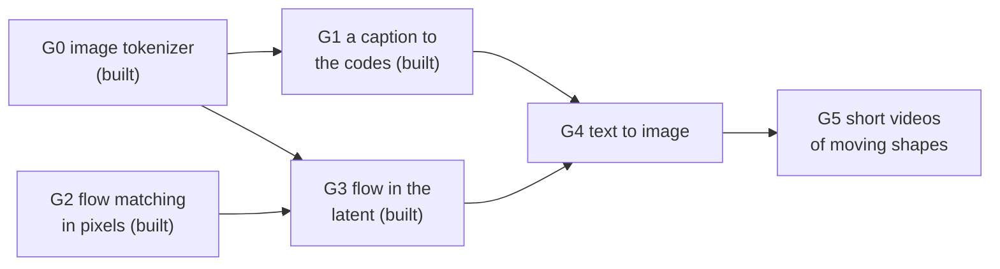
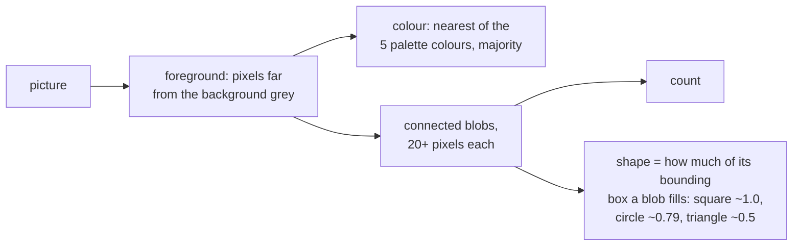
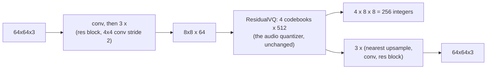
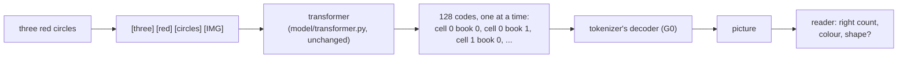
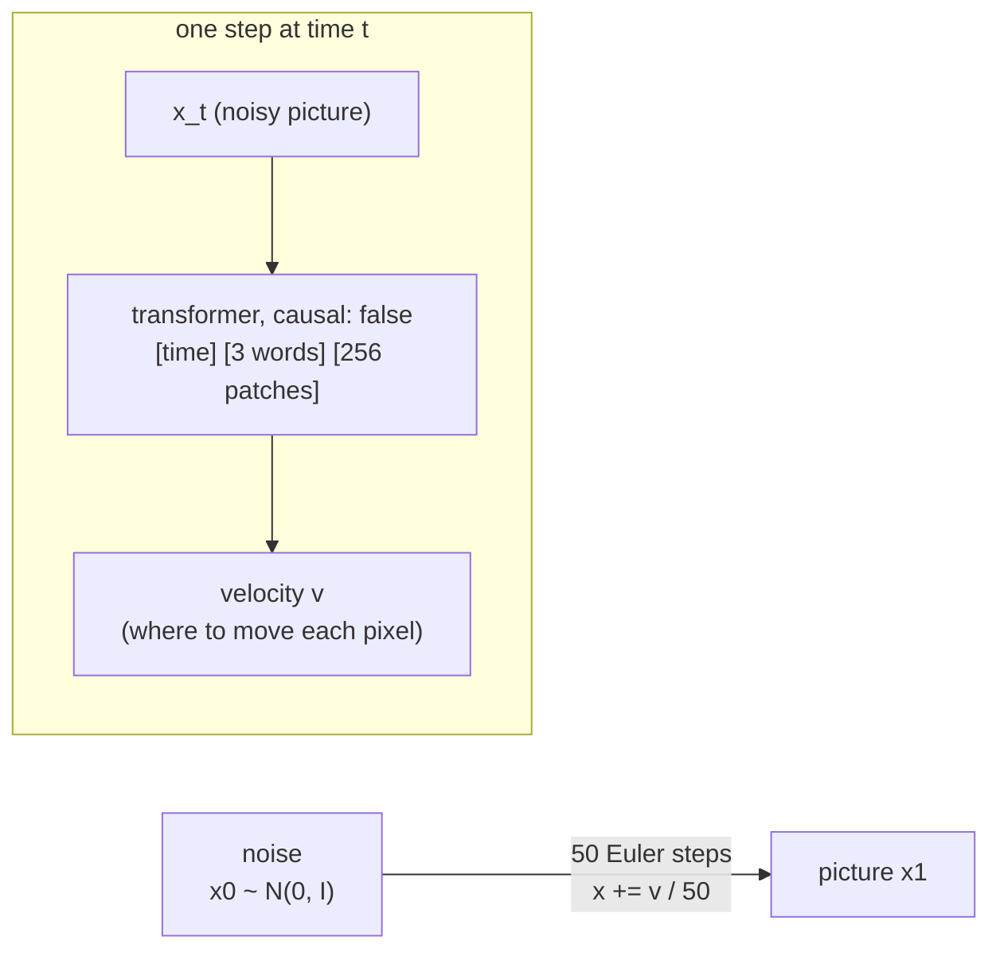
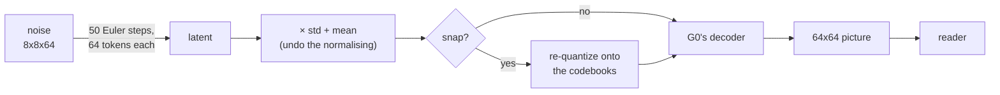
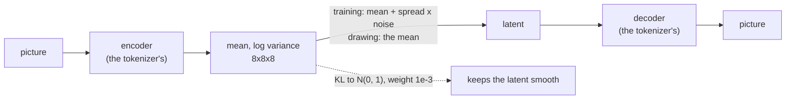

# 26. Making pictures: a picture as integers, and drawing one from a sentence

Everything this repo has generated so far is a sequence of integers: text tokens, codec
codes for speech, the 65 tokens of a game frame. To make it *draw*, a picture first has to
become such a sequence, and that sequence has to turn back into the picture. That is the
**image tokenizer**, the first piece (G0) of the picture line planned in `PLAN.md`. The
second (G1, [below](#from-a-sentence-to-a-picture-g1)) is a transformer that reads "two red
circles" and writes those integers:



It is the audio codec of [chapter 21](21-audio.md) turned sideways: strided convolutions
shrink the input, residual vector quantization turns each cell of what is left into a few
integers, and a mirrored decoder paints the input again. The quantizer
(`audio/vq.py`'s `ResidualVQ`) is **imported unchanged**. Its EMA codebooks, first-batch
seeding, dead-code restart and quantizer dropout were written for speech and carry over to
pictures without an edit.

## The pictures, and why they are drawn rather than downloaded

The corpus is the one the vision chapter ([chapter 22](22-vision.md)) already draws: 64×64
pictures of one to four shapes (circle, square or triangle) in one of five colours, on a
near-black background, each made from a description we chose ("three red circles").
8,000 pictures, 98 MB, rendered in seconds. Purple triangles are never drawn; a separate
set of 64 of them is the **held-out combination**.

Drawing them ourselves is what makes the tokenizer **measurable** rather than merely
demonstrable. A reconstruction of a photograph can only be looked at. A reconstruction of
"three red circles" can be checked: does it still show three, still red, still circles?

## Reading a picture back, with no model

`pictures/reader.py` answers that question by rule:



A learned reader (the vision model) could do this too, but it has its own error rate, and a
tokenizer's mistakes would then be mixed with the reader's. The rule-based reader is
**exact on every original** (all 8,000 and all 64 held-out pictures; a test checks every
count × colour × shape on fresh renders), so whatever it gets wrong on a reconstruction is
the reconstruction's fault. That row, *the originals*, is printed first in every report as
the positive control.

It is also strict in the useful direction: a light blur (σ = 1 pixel) still reads as a
square, a heavy one (σ = 3) reads as a circle, which is exactly what an undertrained
decoder paints (below). A test pins both sides.

## The tokenizer



| choice | why |
|---|---|
| 4×4 kernels at stride 2 down | every input pixel is covered exactly twice, so no checkerboard of pixels seen once and twice |
| nearest upsample + conv up, not a transposed conv | a stride-2 transposed conv overlaps unevenly and paints a faint checkerboard on flat regions, and a shapes picture is almost all flat region |
| GroupNorm, not BatchNorm | a picture's encoding must not depend on what else is in its training batch (the test checks the encoder in *train* mode, the only mode where BatchNorm would leak) |
| L1 + L2 pixel loss | L2 alone blurs edges, L1 alone is slow to fix a whole region's colour; no LPIPS or adversarial loss, because both need a network that is not ours |
| the latent flattened to 64 positions for `ResidualVQ` | raster order, so the quantizer sees `(B, D, T)` exactly as it did for audio |
| quantizer dropout | each batch uses 1 to 4 codebooks, so every prefix decodes (otherwise "1 codebook" is never trained) |

4.55M parameters. An 8×8 grid of 4 codes from 512 is 256 integers, or 2,304 bits, for a
picture of 98,304 bits. `configs/imgtok-shapes16.yaml` is the same model with two halvings
instead of three: a 16×16 grid, 1,024 integers. The pair asks how much the coarser grid
loses, read back by the reader, before G1 has to model 4× longer sequences.

## What a report says

`python -m aksharallm.pictures report <run>` reconstructs the val pictures at 1, 2 and 4
codebooks and writes `logs/pictures/report-<run>-step<N>.json` plus a gallery of PNG rows
(the original, then each codebook count):

| column | meaning |
|---|---|
| PSNR | pixel error in dB. The usual number and a weak one: most of a shapes picture is background, so a lost shape costs little PSNR |
| count / colour / shape / all three | what the reader sees in the reconstruction, against the description it was drawn from |
| held-out: all three | the same on purple triangles, a combination the tokenizer never saw |
| codebook use | distinct entries used and the effective size (perplexity) per codebook. A codebook of 512 with an effective size of 20 is a 20-entry codebook, and **the loss curve cannot show that** |

Each row keeps its per-picture verdicts, so two reports pair picture by picture:
`pictures compare A.json B.json` prints b-only / a-only and an exact sign test, for the val
pictures and the held-out ones. That is how the 8×8 and 16×16 grids are compared.

### The smoke run, 300 steps on the CPU

Not a result (the real run is 20,000 steps on the card), but it shows what the reader is
for. At step 299 the loss had fallen from 1.54 to 0.053, every codebook was in use (339–359
entries of 512), and the reader said:

| codebooks | PSNR | count | colour | shape | all three |
|---|---|---|---|---|---|
| 1 | 25.3 dB | 96.9% | 100% | 26.6% | 26.6% |
| 4 | 26.0 dB | 95.3% | 100% | 26.6% | 26.6% |

Colour and count were already there; **shape was not**. The gallery showed why: every
square came back as a soft round blob. 26 dB of PSNR says "close"; the reader says "a
quarter of these pictures now show the wrong shape". Held-out purple triangles: 0%.

### The full run, 20,000 steps on the card (2026-11-22)

Both grids trained to the end in about a quarter of an hour each (`imgtok-shapes` 4.55M
parameters, 16 min; `imgtok-shapes16` 1.28M, 14 min). 400 val pictures and the 64 held-out
purple triangles, reports from the best checkpoints:

| grid | codebooks | numbers / picture | PSNR (val) | all three (val) | PSNR (held out) | all three (held out) |
|---|---|---|---|---|---|---|
| 8×8 | 1 | 64 | 56.1 dB | 100% | 41.3 dB | 95.3% |
| 8×8 | 2 | 128 | 62.1 dB | 100% | 44.3 dB | 100% |
| 8×8 | 4 | 256 | 63.5 dB | 100% | 46.4 dB | 100% |
| 16×16 | 1 | 256 | 60.2 dB | 100% | 53.3 dB | 100% |
| 16×16 | 4 | 1,024 | 66.7 dB | 100% | 55.1 dB | 100% |

Every codebook is in use (495–511 of 512 entries, effective sizes 38–146). Paired picture by
picture at 4 codebooks the two grids disagree on **nothing** (0 / 0, val and held out), so the
coarser grid loses nothing the reader can see, and G1 models the 8×8 one. The held-out PSNR
is ~15 dB lower than val: purple triangles are reconstructed less exactly, but at one
codebook only three of 64 are misread (their colour), and at two none are.

## Run it

```bash
# G0, the tokenizer
python -m aksharallm.vision corpus                      # data/vision/shapes (seconds), if missing
python -m aksharallm.pictures read                      # the reader on the corpus: must be 100%
scripts/audio.sh imgtok-shapes                          # train (the non-text launcher)
python -m aksharallm.pictures report imgtok-shapes      # ladder + held-out + gallery
python -m aksharallm.pictures reports                   # every report, one line each
python -m aksharallm.pictures compare logs/pictures/report-imgtok-shapes-stepN.json \
    logs/pictures/report-imgtok-shapes16-stepM.json

# G1, a caption to a picture
python -m aksharallm.pictures codes imgtok-shapes --books 2     # data/pictures/codes-imgtok-shapes
# ...or the 64,000-picture corpus the counting fix trains on (docs/26 § Fixing count)
python -m aksharallm.vision corpus --out data/vision/shapes64k --images 64000
python -m aksharallm.pictures codes imgtok-shapes --books 2 --corpus data/vision/shapes64k \
    --out data/pictures/codes-imgtok-shapes-64k
scripts/audio.sh imggen-shapes64k-pos-long                      # the best G1 so far

# G2, flow matching in pixels (same 64k corpus)
scripts/audio.sh flow-shapes
python -m aksharallm.pictures gen-report flow-shapes --guidance 3 --k 32   # --steps N to vary
python -m aksharallm.pictures draw flow-shapes "three purple triangles"
scripts/audio.sh imggen-shapes                                  # train (encodes the codes if missing)
python -m aksharallm.pictures draw imggen-shapes "two red circles" --guidance 3
python -m aksharallm.pictures gen-report imggen-shapes --guidance 3   # all 60 captions, judged
python -m aksharallm.pictures gen-compare A.json B.json               # paired per drawing
```

`scripts/audio.sh` is the launcher for every run whose config is not a text model; it reads
the `picture:` section, renders the corpus if missing, checks the reader on 500 pictures
before spending the card, and publishes the same pid/meta/log contract as every launcher, so
`scripts/stop.sh`, the scheduler and the dashboard's Start drive it unchanged.

In the portal: **Pictures** (under *Reach further*) shows every report with the originals'
row first, the gallery, a paired comparison of two reports, and the jobs (a report, on the
CPU, the reader check, encoding the corpus for G1, a G1 report), each with its CLI command
printed. For G1 it has **Draw**: pick the three words and a guidance, and it draws on the CPU
in a second or two, each picture bordered green or red by the reader's verdict; and **Every
caption, judged**, with the held-out captions first in the gallery.

## From a sentence to a picture (G1)

The tokenizer turns out to be solved on this corpus (the full run, 20,000 steps): every val
picture and every held-out purple triangle reads back right at 4 codebooks, and **one codebook
is already enough for 100% of the val pictures** (56 dB), with 95% on the held-out ones. So G1
models the first **two** codebooks: 64 cells × 2 = 128 codes a picture, all 100% when read back.

G1 is the next-token transformer of [chapter 4](04-model.md), imported unchanged. A picture is
written as a sequence after its caption:



| choice | why |
|---|---|
| one vocabulary: 3 specials + 15 words + 2 × 512 codes | a code from book 1 is a different id from the same number in book 0, so the model always knows which codebook a slot holds |
| position-major order (each cell's two codes together) | the second code refines the first, so it comes straight after it; codebook-major would ask for all 64 refinements before the model has seen any |
| the slot mask in the sampler | at each step only one codebook's 512 ids are legal; the sampler sets the rest to −∞. Training has no mask, so a model that had not learned the layout would show it in the loss |
| loss on codes only | the caption and the IMG marker carry no loss, so the val loss is cross-entropy **per code** (step 0 reads ln 1042 = 6.95, uniform over the whole vocabulary; ln 512 = 6.24 is a model that has learned only which codebook each slot holds) |
| words from the corpus's constants, not its captions | "purple" and "triangles" are words although no picture shows both |
| 10% of captions dropped to `NULL` | the same model then also draws with no caption, which is what guidance needs |

### Guidance

**Classifier-free guidance** is the knob every text-to-image system has. At each sampling step
the model is run twice, with the caption and with `NULL`, and the logits are pushed away from
the captionless ones:

```
logits = uncond + w * (cond - uncond)
```

`w = 1` is the model as trained, `w = 0` ignores the caption, and `w > 1` exaggerates whatever
the caption changes. In a diffusion model the same line is applied to the predicted noise;
here it is applied to the next code's logits. Both halves share one KV cache (2B rows, the
same length).

### How a drawing is scored

`pictures gen-report <run>` draws `k` pictures for each of the **60 captions** the words can
make (4 counts × 5 colours × 3 shapes), reads every one, and reports:

| column | meaning |
|---|---|
| seen / held out | the 56 captions with training pictures, and the 4 purple-triangle captions with none |
| count / colour / shape / all three | the reader's verdict against the caption |
| copies | drawings identical, code for code, to a training picture: memory, not drawing |
| variety | distinct pictures among one caption's `k`: what guidance trades for obedience |

Every (caption, sample) keeps its verdict, and sampling is seeded, so two reports (two guidance
settings, two checkpoints) pair drawing by drawing: `pictures gen-compare A.json B.json`.

### Measured: the first run (2026-11-22)

`imggen-shapes`, 5.09M parameters, 8,000 steps of 64 pictures, trained **on the CPU** (the
launcher refused to share the card with a queued run; ~2–3 s/step, 4 h). Step 0 read 6.99
against ln 1042 = 6.95.

**The val loss and the drawings disagree.** Val loss bottomed at **1.946 at step 2,000** and
then rose steadily to 2.52 at step 7,999 while the training loss kept falling: on likelihood,
7,600 pictures are memorised by 5M parameters. But the drawings did not get worse. Paired on
the same 480 drawings, step 2,000 and step 7,999 are indistinguishable (guidance 3: 83 vs 84
discordant, p 1.0; guidance 1: p 0.50), and neither copies a single training picture. Val
loss scores every possible picture; the sampler only ever visits the likely ones.

Every number below is from `ckpt_best.pt` (step 2,000), 8 drawings per caption (32 where
marked), seed 0:

| guidance | captions | n | count | colour | shape | all three | copies |
|---|---|---|---|---|---|---|---|
| 1 (none) | seen | 1,792 | 68.8% | 98.0% | 98.7% | **66.2%** | 0% |
| 1 (none) | held out | 128 | 68.8% | **35.2%** | 94.5% | **21.9%** | 0% |
| 3 | seen | 1,792 | 65.2% | 98.9% | 94.9% | **62.0%** | 0% |
| 3 | held out | 128 | 57.0% | **84.4%** | 90.6% | **43.0%** | 0% |
| 5 | seen | 448 | 47.5% | 98.0% | 79.7% | 36.8% | 0% |
| 5 | held out | 32 | 37.5% | 87.5% | 84.4% | 21.9% | 0% |

(32 per caption for guidance 1 and 3; variety is 100% everywhere: no caption ever drew the
same picture twice.)

**Guidance is what makes the unseen combination purple.** Without it, "three purple triangles"
comes out as triangles of the right shape in the *wrong* colour: of 128 held-out drawings, 45
are purple, 47 red, 21 blue and 14 yellow, and some single pictures mix two colours, which no
training picture ever does. The word "triangle" pulls towards the colours triangles were seen
in. Guidance exaggerates what the caption changes, and "purple" is part of that, so at
guidance 3 colour rises to 84% and the held-out score doubles, **21.9% → 43.0% (44 drawings
better, 17 worse, p 0.0007)**. It costs a little on captions the model knows, **66.2% → 62.0%
(330 better, 406 worse, p 0.006)**, and guidance 5 breaks shapes (seen 36.8%). That is the
trade every text-to-image system makes with this knob, measured exactly: obedience on the
unfamiliar against fidelity on the familiar.

**Count is the bottleneck.** Colour and shape are 94–99% on seen captions; count is 65–69%,
and its errors are almost all off by one in either direction (guidance 1, 32 per caption: asked for three, 113 drew two,
65 drew four). Counting needs the whole picture at once rather than one region, which is the
same order the vision model learned in (colour, then shape, counting last; chapter 22).


### Fixing count: four arms, one key apart (2026-11-22)

Two hypotheses for why count lagged. **Not enough pictures**: 7,600 pictures for 56 captions is
~136 each, the model memorised them by step 2,000 (val loss rose for the next 6,000 steps), and
counting is the attribute that needs the most examples, because it is a property of the whole
picture rather than of any one region. **No sense of where**: RoPE gives the transformer only a
1-D distance along the sequence, and two codes four steps apart in raster order may be side by
side or on different rows. The fix for the second is a learned *slot embedding*, row + column +
codebook of the code about to be written, added to each input (`picgen.pos2d`,
`PicGenTransformer`, a subclass that leaves `Transformer` untouched). A free check first:
lowering the sampling temperature to 0.4 moved count from 66% to 70%, so the fix had to be in
training.

The bigger corpus is `vision corpus --images 64000` with the same seed, so its first 8,000
pictures **are** the original corpus (checked byte for byte) and the reader is exact on all
64,000. All four arms trained on the GPU, 8,000 steps of 64, same seed, ~3 minutes each
(`logs/queue/g1-count.sh`); `test_the_counting_arms_are_each_one_key_from_the_control` pins
the configs. Final checkpoints, 32 drawings per caption, paired per drawing:

| arm | val (best / final) | seen: count | seen: all | held out: all (g1) | held out: all (g3) |
|---|---|---|---|---|---|
| control, 8k pictures | 1.945 / 2.677 | 65.6% | 63.8% | 14.8% | 48.4% |
| + slot embedding | 1.925 / 2.621 | 67.9% | 67.1% | 35.9% | 45.3% |
| 64k pictures | 1.280 / 1.280 | 83.4% | 83.2% | 68.8% | 67.2% |
| 64k + slot embedding | 1.261 / 1.261 | **86.3%** | **86.0%** | **74.2%** | 71.9% |

(seen columns at guidance 1; colour and shape are ≥ 98% on seen captions in every arm.)

* **More pictures is the fix.** Control → 64k: seen 63.8% → 83.2% (526 drawings better, 179
  worse, p 2e-40), the unseen purple triangles 14.8% → 68.8% (74–5, p 8e-17). The val loss no
  longer turns upward: best and final are the same number, so 8,000 steps under-trains it.
* **The slot embedding helps a little, every time.** +3 points on seen captions at 8k (372–314,
  p 0.03) and at 64k (241–190, p 0.016); its held-out gains are not significant at 64k
  (32–25, p 0.43). A small, real effect on top of the data, not instead of it.
* **The count errors changed shape.** The control mostly drew *too few* (asked minus drawn:
  +1 in 518 drawings, −1 in 129); the 64k + slot model errs both ways and rarely (142 / 120).
* **With enough pictures, guidance is no longer what draws the unseen combination.** At 8k,
  guidance 3 lifted the purple triangles 14.8% → 48.4% (49–6). At 64k + slot it does nothing
  for them (74.2% → 71.9%, p 0.79) and costs 3 points on seen captions (205–266, p 0.006): the
  model already binds "purple" to the triangles without being pushed. Guidance was
  compensating for a model that had not learned the words well enough.
* Copies stay at 0–0.3%, variety at 100%.

**And longer.** Because the 64k arms were still improving at 8,000 steps, the winning arm ran
again for 30,000 (`imggen-shapes64k-pos-long`, 11 minutes): val 1.261 → **1.125**, seen
captions **89.0%** at guidance 1 (count 89.1%; paired against the 8,000-step arm 195–143,
p 0.006), the purple triangles 70.3% (g1) / 77.3% (g3), not different from the shorter run
(p 0.58). What is left of the counting error grows with the number: asked for one shape it
draws one 98% of the time, two 92%, three 86%, four 80%, and it now errs almost only by drawing
one too few. From the first run to this one, count went **65.6% → 89.1%** and the never-seen
combination **14.8% → 70.3%** without guidance. It is the model the portal's Draw now picks
first (the newest checkpoint).

## G2: drawing by flow matching

G1 writes a picture one code at a time. **G2 starts from pure noise and moves the whole picture
towards a drawing**, in 50 small steps, steered by the caption at every one: the way Stable
Diffusion 3, Flux and the Veo/Sora family generate. It works in pixels (the latent version is
G3), on the same 64,000 pictures, and is scored by the same reader on the same 60 captions,
so G1 and G2 compare drawing for drawing.



**The training rule is four lines** (`pictures/flow.py`, `flow_loss`):

```
x0 ~ N(0, I)                     noise
x_t = (1 - t) x0 + t x1          a straight line from noise (t = 0) to a training picture (t = 1)
target = x1 - x0                 the direction along that line: its velocity
loss = | model(x_t, t, caption) - target |^2
```

This is **flow matching** (rectified flow). There is no noise schedule to tune (DDPM's betas and
alphas), and because the paths are straight, drawing takes tens of steps instead of a thousand.
Times are drawn from a logit-normal (as Stable Diffusion 3 does): most training happens where
the picture is half formed, which is where the decisions are.

**The model is the same transformer a third time.** A picture is cut into 16×16 patches of 4×4
pixels; each patch becomes a token (plus a row and column embedding), and the time step and
the three caption words become four more tokens in front. `model/transformer.py` runs over
them unchanged with `causal: false` (every patch sees every other patch, as in masked
diffusion, chapter 20), and a linear head reads a velocity off each patch's hidden state. The
caption enters **in context**, as tokens, not through a new kind of block (DiT's adaLN): the
transformer is told nothing. The config says so in a new key, `embeds_only: true`, because a
bidirectional model with no mask token used to be refused as having nothing to train on, and
here the objective is outside it.

| choice | why |
|---|---|
| straight paths, predict velocity | the simplest objective that samples in few steps; the loss is a plain MSE |
| output layer initialised to zero | step 0 predicts zero velocity, so the first loss is a known number, 1 + mean(x1²) ≈ 1.72 here |
| logit-normal times | little training at t ≈ 0 (pure noise) and t ≈ 1 (finished picture), where there is nothing to learn |
| fixed seed for val | val uses the same pictures, noise and times every time, so "best" is never the kindest noise |
| guidance on velocities | `v = v_uncond + w (v_cond − v_uncond)`, the same line as G1's, on a different quantity |
| copies and variety through the tokenizer | drawn pixels are encoded by G0 and checked against the training pictures' codes, exactly as G1's drawings are |

`pictures/drawer.py` is one door for both models: `draw`, `gen-report` and the portal's Draw
panel load a G1 or a G2 checkpoint the same way, and `gen-compare` pairs a G2 report against a
G1 one when they drew the same captions with the same k and seed.

### Measured: G2 against G1 (2026-11-22)

`flow-shapes`, 14.5M parameters, 30,000 steps of 64 pictures on the GPU in 56 minutes (0.17
s/step beside another run, 0.08 alone). Step 0 read 1.716 (zero velocity, as predicted); val
fell to **0.0047** and never turned upward. During training (2 drawings per caption, guidance
3) the score went 56% → 83% → 68% → 98% → 99% → 100% at steps 5k–30k.

On the same 60 captions, 32 drawings each, same seed, against the best G1
(`imggen-shapes64k-pos-long`, same 64,000 pictures, same 30,000 steps):

| model | guidance | seen: count | seen: all three | held out: all three | copies |
|---|---|---|---|---|---|
| G1 (codes, one at a time) | 1 | 89.1% | 89.0% | 70.3% | 0% |
| **G2 (flow matching, pixels)** | 1 | **99.2%** | **99.2%** | **100%** | 0% |
| G1 | 3 | 86.4% | 84.5% | 77.3% | 0% |
| **G2** | 3 | 99.1% | 99.1% | 100% | 0% |

Paired drawing by drawing at guidance 1: seen **197 better, 13 worse (p 2e-43)**, the purple
triangles **38 better, 0 worse (p 7e-12)**. Colour and shape are 100% everywhere, count 99%,
every one of the 128 held-out drawings is right, no drawing is a copy of a training picture,
and no caption ever drew the same picture twice. Guidance changes nothing (99.2% vs 99.1%):
the model already obeys the words.

**Why G2 counts where G1 could not.** G1 commits to the top-left cell first and can never take
it back; by the time it learns there should have been one more triangle, the cells where it
could go are written. G2 decides the whole picture together and revises it at every step:
"how many shapes are there" is a question about the picture as a whole, and every step of G2
looks at the picture as a whole.

**How few steps it needs** (guidance 1, 8 per caption):

| Euler steps | 2 | 5 | 10 | 25 | 50 |
|---|---|---|---|---|---|
| seen: all three | 40.0% | 94.9% | 98.0% | 99.1% | 99.2% |
| held out: all three | 9.4% | 87.5% | 96.9% | 100% | 100% |

Straight paths are what make this possible: 10 steps give 98%, where DDPM-style diffusion
needs hundreds. G2's drawing costs 50 forward passes of a 14.5M model; G1's costs 128 passes of
a 5M one, so the two are within a factor of about two in compute per picture.

The shapes corpus is now solved by G2. What it cannot show is detail, texture or real
captions; that is what G3 (the same thing in G0's latent, far cheaper per step) and G4 (real
text, real pictures) are for.

## G3: flow matching in the latent

G2 works on 12,288 numbers a picture. Most of them are predictable from their neighbours (a
pixel inside a red square is red), so every real image model, Stable Diffusion, Flux and Veo
included, works in a smaller space and lets a decoder paint the pixels. G3 does exactly that
with what this chapter already has: G0's encoder gives an **8×8×64 latent** (4,096 numbers),
G2's flow model draws one of those instead of a picture, and G0's decoder paints it.



Nothing new is trained except the flow model: `pictures/flow.py` with `space: latent`,
`patch: 1`, `channels: 64` (one token per latent cell, 64 tokens against G2's 256), the same
width, depth, steps, schedule and seed as G2 (`configs/flow-latent-shapes.yaml`, one block
apart from `flow-shapes.yaml`).

Three decisions in `pictures/latents.py`:

| decision | why |
|---|---|
| the latent is `q`, the quantized sum at all 4 codebooks, not the encoder's raw `z` | the decoder only ever saw `q`; `z` is a point it was never trained to paint |
| normalised per channel, statistics from the training split | flow matching starts from unit-variance noise; a latent whose channels range from 0.1 to 0.5 in scale would make the straight line mostly a change of scale. The mean and std go into every checkpoint |
| optional **snap** before decoding | re-quantizing a drawn latent onto the codebooks removes small off-grid errors the decoder never saw; measured both ways |

The round trip is checked before anything trains: the 300 val latents, mapped back and decoded,
read 100% right (with or without snapping). Decoded **without** mapping them back, the same
latents read 62% right, which is the silent bug lesson 32 plants.

`pictures latents imgtok-shapes --corpus data/vision/shapes64k` writes the corpus (524 MB of
float16, 5 minutes on the CPU); `scripts/audio.sh flow-latent-shapes` encodes it if missing.

### Measured: G3 against G2 (2026-11-22)

`flow-latent-shapes`, 14.5M parameters (the same transformer as G2), 30,000 steps, run on the
card with the hybrid paused. **16 minutes**, 0.030–0.037 s/step against G2's 0.083 alone: 64
tokens instead of 256 makes every step ~2.5× cheaper. Val (fixed noise, in normalised latent
units, so not comparable with G2's pixel val) 0.110 → 0.0386, still falling at the end.

32 drawings per caption, paired with G2 on the same captions and seed:

| model | guidance | seen: count | seen: all three | held out: all three | copies |
|---|---|---|---|---|---|
| G2 (pixels) | 1 | 99.2% | **99.2%** | **100%** | 0% |
| G3 (latent) | 1 | 87.7% | 87.6% | 79.7% | 0.7% |
| G3, snapped | 1 | 87.7% | 87.6% | 78.9% | 0.8% |
| G3 | 3 | 85.4% | 85.3% | 74.2% | 1.2% |

Paired at guidance 1: G2 is right where G3 is wrong 216 times, the reverse 8 (p 1e-53); on the
purple triangles 26 to 0 (p 3e-8). **Colour and shape survive the move to the latent (≥ 99.8%);
count does not.** It is 96% for one shape and 80% for four, and the gallery shows why: G3 now
and then puts two shapes **touching**, which no training picture does (the corpus spaces them on
a grid), and the reader rightly sees one blob. Its count errors go both ways (one too many in
159 drawings, one too few in 84). Snapping to the codebooks changes nothing; guidance 3 hurts.

The likeliest reason is resolution: a latent cell covers 8×8 pixels, so G3 decides where a
shape goes on a 64-cell grid, where G2 decides on 256 cells of 4×4 pixels, and a misplaced cell
is a shape eight pixels out. The copies (0.7%) are all one-square captions, which have only
about two hundred possible layouts; identical code grids there are coincidence, not memory.

So the trade is the one latent models make, measured: **~2.5× cheaper per step for a loss in
placement precision**, at the same number of steps.

### Is it the latent's resolution? No (2026-11-22)

The obvious test of "8×8 cells are too coarse" is the 16×16 tokenizer, `imgtok-shapes16`, which
is already trained and reconstructs every picture perfectly (G0). Two arms on its 16×16×64
latent, each one config block from G3 (`configs/flow-latent16p2-shapes.yaml`,
`flow-latent16-shapes.yaml`; same width, depth, steps, schedule and seed):

| arm | latent | tokens | 30k steps | seen: count | seen: all three | held out |
|---|---|---|---|---|---|---|
| G2 | pixels, 12,288 numbers | 256 | ~42 min | 99.2% | **99.2%** | **100%** |
| G3 | 8×8×64, 4,096 numbers | 64 | 16 min | 87.7% | **87.6%** | **79.7%** |
| G3-16, 2×2 cells per token | 16×16×64, 16,384 numbers | 64 | 16 min | 52.3% | 51.4% | 32.0% |
| G3-16, 1 cell per token | 16×16×64, 16,384 numbers | 256 | 44 min | 50.8% | 50.3% | 27.3% |

The finer latent is **far worse**, not better (G3 against either arm: 748–99 and 761–92 drawings,
p < 1e-120), and the two 16×16 arms are the same as each other (358–378, p 0.48): four times the
tokens bought nothing. The drawings are clean, crisp shapes of the right colour and kind in the
wrong number, with errors both ways (asked for three: two, four, five).

So the explanation in the previous section was wrong, or at least not the main thing. What the
numbers do say:

* **A latent that reconstructs perfectly is not automatically one a generator can learn.** Both
  tokenizers decode every picture right. The 16×16 one is shallower (two halvings, 1.28M
  parameters against 4.55M) and its latent holds *more* numbers than the picture (16,384 against
  12,288), so it is less a summary of the picture than a re-encoding of its pixels.
* **It is not the token count**, since 64 and 256 tokens score the same on it, and not raw size
  alone, since G2 draws 12,288 pixel values with 256 tokens at 99%.
* Every latent here is a sum of four codebook vectors, so its values cluster rather than vary
  smoothly the way pixels do; a flow learns a smooth path to a target, and a clustered target
  may be what makes the bigger latent hard. That is a hypothesis, not a measurement.

This is why real latent models do not use a plain VQ tokenizer's latent: Stable Diffusion's
autoencoder is trained with a small KL penalty that keeps its latent smooth and roughly
Gaussian, precisely so that a diffusion model can learn it. The next section is that experiment.

### A latent made to be learned: G3b (2026-11-22)

`pictures/autoencoder.py` keeps the tokenizer's encoder and decoder and replaces the codebooks
with a **Gaussian latent**: the encoder predicts a mean and a log variance per latent number,
training decodes a sample (mean + spread × noise), and a small KL term (weight 1e-3) pulls every
latent towards a unit Gaussian. The latent is **8×8×8 = 512 numbers**, against the VQ latents'
4,096 and 16,384. For drawing, the latent is the encoder's mean.



`ae-shapes` trained in 16 minutes and reconstructs **100%** of the val pictures and of the
held-out purple triangles (56 dB). Three of its eight channels carry almost nothing (spread
0.02 against 0.4–0.7): the KL term turned them off, which the decoder ignores. Then G3's flow
model, unchanged, on its latent (`flow-ae-shapes`, one block from `flow-latent-shapes`; copies
are still checked with the VQ tokenizer's codes, `flow.score_tokenizer`):

| model | what it draws | numbers | 30k steps | seen: all three | held out |
|---|---|---|---|---|---|
| G2 | pixels | 12,288 | ~42 min | 99.2% | 100% |
| G3 | VQ latent, 8×8×64 | 4,096 | 16 min | 87.6% | 79.7% |
| G3 | VQ latent, 16×16×64 | 16,384 | 16–44 min | ~51% | ~30% |
| **G3b** | **continuous latent, 8×8×8** | **512** | **15.5 min** | **98.9%** | **97.7%** |

G3b against G2, paired: 13 better, 18 worse on seen captions (**p 0.47, a tie**), 0–3 on the
held-out ones (p 0.25); against G3: 220–17 (p 4e-46). Colour, shape and count are all ≥ 97.7%,
no copies, every drawing different.

**So the explanation holds**: the VQ latents were hard because of what they were, not how big.
A smooth latent made for the purpose, a twenty-fourth the size of the picture, draws as well as
the pixels at a third of the cost, which is the whole case for latent diffusion. This
autoencoder is what G4 (real sentences and photos) will build on.

## Traps to keep

1. **A score that borrows a name it does not earn.** There is no FID here: FID needs a
   pretrained Inception network. When G1+ need a distribution score, it will be a distance
   in the feature space of *our own* classifier, named as such (gotcha 12).
2. **Codebook collapse is silent.** Printed every logged step (`used a/b/c/d`) and in every
   report.
3. **`ImageCaptions(val_frac=0)` still keeps one picture back** (`max(1, …)`), so the first
   reader check said "7,999 of 7,999". The reader and the held-out scores read the whole set
   as one split (`split="val", val_frac=1.0`).
4. **A report started from the browser runs on the CPU**: a button must never put work on a
   card someone else is using. The night queue passes `--device cuda` itself.

## The code, in reading order

| # | file | what to look for |
|---|---|---|
| 1 | [`pictures/reader.py`](../aksharallm/pictures/reader.py) → `read`, `judge` | foreground by distance from the background, blobs by flood fill, shape by bounding-box fill; why the reader must be exact on the originals |
| 2 | [`pictures/tokenizer.py`](../aksharallm/pictures/tokenizer.py) → `PictureConfig`, `PictureTokenizer` | the 2-D codec: encoder, `ResidualVQ` on the flattened grid, decoder; `encode`/`decode` and the codebook-prefix dial |
| 3 | [`audio/vq.py`](../aksharallm/audio/vq.py) → `ResidualVQ` | the quantizer, unchanged from audio: EMA, seeding, restart, dropout |
| 4 | [`pictures/train.py`](../aksharallm/pictures/train.py) → `main` | the trainer contract (pid, STOP, session records, resume with the data generator's state), codebook use every logged step |
| 5 | [`pictures/measure.py`](../aksharallm/pictures/measure.py) → `ladder`, `compare`, `gallery` | PSNR, the reader at each codebook count, codebook use, per-picture verdicts paired by a sign test |
| 6 | [`pictures/__main__.py`](../aksharallm/pictures/__main__.py) | `read`, `report`, `compare`, `reports` |
| 7 | [`pictures/codes.py`](../aksharallm/pictures/codes.py) → `WORDS`, `flatten`, `CodesDataset.rows` | G1's vocabulary of words and codes, position-major order, the loss on codes only, the `NULL` caption |
| 8 | [`pictures/gen.py`](../aksharallm/pictures/gen.py) → `sample`, `draw`, `PicGenTransformer` | the slot mask, classifier-free guidance over one shared KV cache, decoding through the tokenizer; the (row, column, codebook) slot embedding, taken from the cache's offset while decoding |
| 9 | [`pictures/train_gen.py`](../aksharallm/pictures/train_gen.py) → `main` | the same trainer contract; refuses codes from a different tokenizer; draws all 60 captions at each sample |
| 10 | [`pictures/score.py`](../aksharallm/pictures/score.py) → `report`, `compare` | seen vs held-out captions, copies of training pictures, variety, per-drawing verdicts paired |
| 11 | [`pictures/flow.py`](../aksharallm/pictures/flow.py) → `flow_loss`, `sample`, `FlowModel` | G2: the straight path and its velocity, Euler sampling with guidance, the transformer run bidirectionally over [time, words, patches] |
| 12 | [`pictures/train_flow.py`](../aksharallm/pictures/train_flow.py) → `evaluate`, `main` | the trainer contract again; val on fixed pictures, noise and times |
| 13 | [`pictures/latents.py`](../aksharallm/pictures/latents.py) → `picture_latent`, `encode_latents`, `decode_latent` | G3's corpus: the quantized latent, per-channel normalising from the training split, decoding with or without snapping |
| 14 | [`pictures/autoencoder.py`](../aksharallm/pictures/autoencoder.py) → `PictureAutoencoder` · [`train_ae.py`](../aksharallm/pictures/train_ae.py) | G3b's coder: the tokenizer's encoder and decoder around a Gaussian latent, the KL term, drawing from the mean; its trainer judges reconstructions with the reader |
| 15 | [`pictures/drawer.py`](../aksharallm/pictures/drawer.py) → `load_drawer` | one door for G1, G2 and G3: draw, score, copies through the tokenizer |
| 16 | [`portal/pictures.py`](../aksharallm/portal/pictures.py) · [`static/js/pictures.js`](../aksharallm/portal/static/js/pictures.js) | the Pictures tab: reports with the gallery inlined (paths re-checked to sit inside `logs/pictures/`), compare, inline Draw, jobs through `portal/jobs.py` |

Tests: `tests/test_pictures.py`. They cover the reader on every count × colour × shape, the
reader seeing blur and recolouring, the codebook prefix ignoring later codebooks, batch
independence in train mode, the ladder and the paired compare, the trainer's save and
resume, and the portal refusing a gallery path outside `logs/pictures/`. Six mutants were
checked red: loose shape thresholds, swapped compare columns, a missing containment check,
BatchNorm in place of GroupNorm, a resume restarting at step 0, and a prefix decode reading
every codebook. [Lesson 29](lessons/29-pictures.md) breaks the reader.

`tests/test_picgen.py` covers G1: the flatten order and its inverse, the loss on codes only and
the dropped caption, the slot mask, guidance (a constructed model that prefers one code with a
caption and another without, so `w = 0`, `1` and `3` must each pick the right one), the paired
comparison refusing different captions, the trainer's resume and its refusal of another
tokenizer's codes, and the portal's inline draw. Six mutants were checked red: guidance halves
swapped, guidance ignoring the unconditional half, the IMG marker left in the loss, codebook-major
flattening, the wrong slot range, and the tokenizer check removed.
The slot embedding adds three more: the slot names the right cell and codebook, cached decoding
matches the full forward (red if the offset is taken as 0, if the slot is off by one, or if row
and column are swapped), and a `pos2d` checkpoint round-trips.
[Lesson 30](lessons/30-guidance.md) breaks guidance.

`tests/test_flow.py` covers G2 with exact oracles: patches cut and put back in raster order; a
velocity field that knows the picture must be integrated onto it exactly; the true velocity
scores zero loss and its negative does not; guidance must combine a model that says +0.1 with
a caption and −0.1 without in the right proportions; patch 0 must change when only the last
patch does (bidirectional); val loss is repeatable; and the drawing door and the portal take a
G2 checkpoint. Six mutants were checked red: times one step late, the target's sign flipped,
guidance halves swapped, a causal transformer, stepping backwards, and patches out of order.
[Lesson 31](lessons/31-flow-matching.md) flips the velocity.

G3 adds three tests: latents normalised on the training split decode back to the tokenizer's own
`q` (float16 storage aside); an oracle that flows to a known normalised latent must produce the
decoder's picture of the *denormalised* latent (and a latent model without its tokenizer is
refused); and a G3 run carries its statistics into the checkpoint, draws through the door as
G3, and refuses latents written by a different tokenizer. Four mutants were checked red: no
denormalising, the latent clamped like pixels, no tokenizer check, statistics not saved.
[Lesson 32](lessons/32-latent.md) skips the denormalising.

G3b adds three: the autoencoder draws from its mean in eval mode and its KL is zero at the prior;
one loader opens either coder and G3's latents come from the autoencoder's mean (with nothing to
snap to); and a G3b run scores copies with the VQ tokenizer, not the autoencoder. Three mutants
were checked red: sampling in eval mode, ignoring the autoencoder's latent, and scoring with the
autoencoder.
