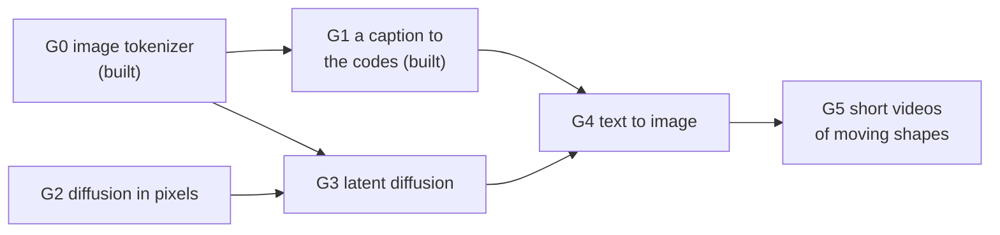
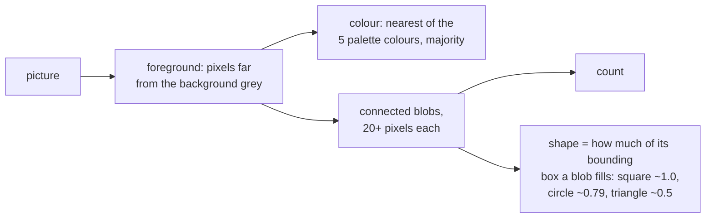
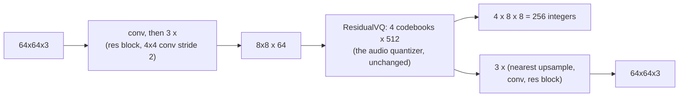
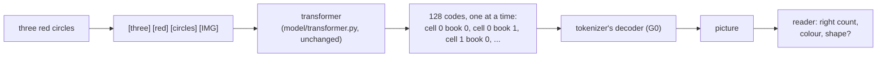

# 26. Making pictures: a picture as integers, and drawing one from a sentence

Everything this repo has generated so far is a sequence of integers: text tokens, codec
codes for speech, the 65 tokens of a game frame. To make it *draw*, a picture first has to
become such a sequence, and that sequence has to turn back into the picture. That is the
**image tokenizer**, the first piece (G0) of the picture line planned in `PLAN.md`. The
second (G1, [below](#from-a-sentence-to-a-picture-g1)) is a transformer that reads "two red
circles" and writes those integers:



It is the audio codec of [chapter 21](21-audio.md) turned sideways: strided convolutions
shrink the input, residual vector quantization turns each cell of what is left into a few
integers, and a mirrored decoder paints the input again. The quantizer
(`audio/vq.py`'s `ResidualVQ`) is **imported unchanged**. Its EMA codebooks, first-batch
seeding, dead-code restart and quantizer dropout were written for speech and carry over to
pictures without an edit.

## The pictures, and why they are drawn rather than downloaded

The corpus is the one the vision chapter ([chapter 22](22-vision.md)) already draws: 64×64
pictures of one to four shapes (circle, square or triangle) in one of five colours, on a
near-black background, each made from a description we chose ("three red circles").
8,000 pictures, 98 MB, rendered in seconds. Purple triangles are never drawn; a separate
set of 64 of them is the **held-out combination**.

Drawing them ourselves is what makes the tokenizer **measurable** rather than merely
demonstrable. A reconstruction of a photograph can only be looked at. A reconstruction of
"three red circles" can be checked: does it still show three, still red, still circles?

## Reading a picture back, with no model

`pictures/reader.py` answers that question by rule:



A learned reader (the vision model) could do this too, but it has its own error rate, and a
tokenizer's mistakes would then be mixed with the reader's. The rule-based reader is
**exact on every original** (all 8,000 and all 64 held-out pictures; a test checks every
count × colour × shape on fresh renders), so whatever it gets wrong on a reconstruction is
the reconstruction's fault. That row, *the originals*, is printed first in every report as
the positive control.

It is also strict in the useful direction: a light blur (σ = 1 pixel) still reads as a
square, a heavy one (σ = 3) reads as a circle, which is exactly what an undertrained
decoder paints (below). A test pins both sides.

## The tokenizer



| choice | why |
|---|---|
| 4×4 kernels at stride 2 down | every input pixel is covered exactly twice, so no checkerboard of pixels seen once and twice |
| nearest upsample + conv up, not a transposed conv | a stride-2 transposed conv overlaps unevenly and paints a faint checkerboard on flat regions, and a shapes picture is almost all flat region |
| GroupNorm, not BatchNorm | a picture's encoding must not depend on what else is in its training batch (the test checks the encoder in *train* mode, the only mode where BatchNorm would leak) |
| L1 + L2 pixel loss | L2 alone blurs edges, L1 alone is slow to fix a whole region's colour; no LPIPS or adversarial loss, because both need a network that is not ours |
| the latent flattened to 64 positions for `ResidualVQ` | raster order, so the quantizer sees `(B, D, T)` exactly as it did for audio |
| quantizer dropout | each batch uses 1 to 4 codebooks, so every prefix decodes (otherwise "1 codebook" is never trained) |

4.55M parameters. An 8×8 grid of 4 codes from 512 is 256 integers, or 2,304 bits, for a
picture of 98,304 bits. `configs/imgtok-shapes16.yaml` is the same model with two halvings
instead of three: a 16×16 grid, 1,024 integers. The pair asks how much the coarser grid
loses, read back by the reader, before G1 has to model 4× longer sequences.

## What a report says

`python -m aksharallm.pictures report <run>` reconstructs the val pictures at 1, 2 and 4
codebooks and writes `logs/pictures/report-<run>-step<N>.json` plus a gallery of PNG rows
(the original, then each codebook count):

| column | meaning |
|---|---|
| PSNR | pixel error in dB. The usual number and a weak one: most of a shapes picture is background, so a lost shape costs little PSNR |
| count / colour / shape / all three | what the reader sees in the reconstruction, against the description it was drawn from |
| held-out: all three | the same on purple triangles, a combination the tokenizer never saw |
| codebook use | distinct entries used and the effective size (perplexity) per codebook. A codebook of 512 with an effective size of 20 is a 20-entry codebook, and **the loss curve cannot show that** |

Each row keeps its per-picture verdicts, so two reports pair picture by picture:
`pictures compare A.json B.json` prints b-only / a-only and an exact sign test, for the val
pictures and the held-out ones. That is how the 8×8 and 16×16 grids are compared.

### The smoke run, 300 steps on the CPU

Not a result (the real run is 20,000 steps on the card), but it shows what the reader is
for. At step 299 the loss had fallen from 1.54 to 0.053, every codebook was in use (339–359
entries of 512), and the reader said:

| codebooks | PSNR | count | colour | shape | all three |
|---|---|---|---|---|---|
| 1 | 25.3 dB | 96.9% | 100% | 26.6% | 26.6% |
| 4 | 26.0 dB | 95.3% | 100% | 26.6% | 26.6% |

Colour and count were already there; **shape was not**. The gallery showed why: every
square came back as a soft round blob. 26 dB of PSNR says "close"; the reader says "a
quarter of these pictures now show the wrong shape". Held-out purple triangles: 0%.

### The full run, 20,000 steps on the card (2026-11-22)

Both grids trained to the end in about a quarter of an hour each (`imgtok-shapes` 4.55M
parameters, 16 min; `imgtok-shapes16` 1.28M, 14 min). 400 val pictures and the 64 held-out
purple triangles, reports from the best checkpoints:

| grid | codebooks | numbers / picture | PSNR (val) | all three (val) | PSNR (held out) | all three (held out) |
|---|---|---|---|---|---|---|
| 8×8 | 1 | 64 | 56.1 dB | 100% | 41.3 dB | 95.3% |
| 8×8 | 2 | 128 | 62.1 dB | 100% | 44.3 dB | 100% |
| 8×8 | 4 | 256 | 63.5 dB | 100% | 46.4 dB | 100% |
| 16×16 | 1 | 256 | 60.2 dB | 100% | 53.3 dB | 100% |
| 16×16 | 4 | 1,024 | 66.7 dB | 100% | 55.1 dB | 100% |

Every codebook is in use (495–511 of 512 entries, effective sizes 38–146). Paired picture by
picture at 4 codebooks the two grids disagree on **nothing** (0 / 0, val and held out), so the
coarser grid loses nothing the reader can see, and G1 models the 8×8 one. The held-out PSNR
is ~15 dB lower than val: purple triangles are reconstructed less exactly, but at one
codebook only three of 64 are misread (their colour), and at two none are.

## Run it

```bash
# G0, the tokenizer
python -m aksharallm.vision corpus                      # data/vision/shapes (seconds), if missing
python -m aksharallm.pictures read                      # the reader on the corpus: must be 100%
scripts/audio.sh imgtok-shapes                          # train (the non-text launcher)
python -m aksharallm.pictures report imgtok-shapes      # ladder + held-out + gallery
python -m aksharallm.pictures reports                   # every report, one line each
python -m aksharallm.pictures compare logs/pictures/report-imgtok-shapes-stepN.json \
    logs/pictures/report-imgtok-shapes16-stepM.json

# G1, a caption to a picture
python -m aksharallm.pictures codes imgtok-shapes --books 2     # data/pictures/codes-imgtok-shapes
scripts/audio.sh imggen-shapes                                  # train (encodes the codes if missing)
python -m aksharallm.pictures draw imggen-shapes "two red circles" --guidance 3
python -m aksharallm.pictures gen-report imggen-shapes --guidance 3   # all 60 captions, judged
python -m aksharallm.pictures gen-compare A.json B.json               # paired per drawing
```

`scripts/audio.sh` is the launcher for every run whose config is not a text model; it reads
the `picture:` section, renders the corpus if missing, checks the reader on 500 pictures
before spending the card, and publishes the same pid/meta/log contract as every launcher, so
`scripts/stop.sh`, the scheduler and the dashboard's Start drive it unchanged.

In the portal: **Pictures** (under *Reach further*) shows every report with the originals'
row first, the gallery, a paired comparison of two reports, and the jobs (a report, on the
CPU, the reader check, encoding the corpus for G1, a G1 report), each with its CLI command
printed. For G1 it has **Draw**: pick the three words and a guidance, and it draws on the CPU
in a second or two, each picture bordered green or red by the reader's verdict; and **Every
caption, judged**, with the held-out captions first in the gallery.

## From a sentence to a picture (G1)

The tokenizer turns out to be solved on this corpus (the full run, 20,000 steps): every val
picture and every held-out purple triangle reads back right at 4 codebooks, and **one codebook
is already enough for 100% of the val pictures** (56 dB), with 95% on the held-out ones. So G1
models the first **two** codebooks: 64 cells × 2 = 128 codes a picture, all 100% when read back.

G1 is the next-token transformer of [chapter 4](04-model.md), imported unchanged. A picture is
written as a sequence after its caption:



| choice | why |
|---|---|
| one vocabulary: 3 specials + 15 words + 2 × 512 codes | a code from book 1 is a different id from the same number in book 0, so the model always knows which codebook a slot holds |
| position-major order (each cell's two codes together) | the second code refines the first, so it comes straight after it; codebook-major would ask for all 64 refinements before the model has seen any |
| the slot mask in the sampler | at each step only one codebook's 512 ids are legal; the sampler sets the rest to −∞. Training has no mask, so a model that had not learned the layout would show it in the loss |
| loss on codes only | the caption and the IMG marker carry no loss, so the val loss is cross-entropy **per code** (step 0 reads ln 1042 = 6.95, uniform over the whole vocabulary; ln 512 = 6.24 is a model that has learned only which codebook each slot holds) |
| words from the corpus's constants, not its captions | "purple" and "triangles" are words although no picture shows both |
| 10% of captions dropped to `NULL` | the same model then also draws with no caption, which is what guidance needs |

### Guidance

**Classifier-free guidance** is the knob every text-to-image system has. At each sampling step
the model is run twice, with the caption and with `NULL`, and the logits are pushed away from
the captionless ones:

```
logits = uncond + w * (cond - uncond)
```

`w = 1` is the model as trained, `w = 0` ignores the caption, and `w > 1` exaggerates whatever
the caption changes. In a diffusion model the same line is applied to the predicted noise;
here it is applied to the next code's logits. Both halves share one KV cache (2B rows, the
same length).

### How a drawing is scored

`pictures gen-report <run>` draws `k` pictures for each of the **60 captions** the words can
make (4 counts × 5 colours × 3 shapes), reads every one, and reports:

| column | meaning |
|---|---|
| seen / held out | the 56 captions with training pictures, and the 4 purple-triangle captions with none |
| count / colour / shape / all three | the reader's verdict against the caption |
| copies | drawings identical, code for code, to a training picture: memory, not drawing |
| variety | distinct pictures among one caption's `k`: what guidance trades for obedience |

Every (caption, sample) keeps its verdict, and sampling is seeded, so two reports (two guidance
settings, two checkpoints) pair drawing by drawing: `pictures gen-compare A.json B.json`.

**MEASURED** — filled in below after the run.

## Traps to keep

1. **A score that borrows a name it does not earn.** There is no FID here: FID needs a
   pretrained Inception network. When G1+ need a distribution score, it will be a distance
   in the feature space of *our own* classifier, named as such (gotcha 12).
2. **Codebook collapse is silent.** Printed every logged step (`used a/b/c/d`) and in every
   report.
3. **`ImageCaptions(val_frac=0)` still keeps one picture back** (`max(1, …)`), so the first
   reader check said "7,999 of 7,999". The reader and the held-out scores read the whole set
   as one split (`split="val", val_frac=1.0`).
4. **A report started from the browser runs on the CPU**: a button must never put work on a
   card someone else is using. The night queue passes `--device cuda` itself.

## The code, in reading order

| # | file | what to look for |
|---|---|---|
| 1 | [`pictures/reader.py`](../aksharallm/pictures/reader.py) → `read`, `judge` | foreground by distance from the background, blobs by flood fill, shape by bounding-box fill; why the reader must be exact on the originals |
| 2 | [`pictures/tokenizer.py`](../aksharallm/pictures/tokenizer.py) → `PictureConfig`, `PictureTokenizer` | the 2-D codec: encoder, `ResidualVQ` on the flattened grid, decoder; `encode`/`decode` and the codebook-prefix dial |
| 3 | [`audio/vq.py`](../aksharallm/audio/vq.py) → `ResidualVQ` | the quantizer, unchanged from audio: EMA, seeding, restart, dropout |
| 4 | [`pictures/train.py`](../aksharallm/pictures/train.py) → `main` | the trainer contract (pid, STOP, session records, resume with the data generator's state), codebook use every logged step |
| 5 | [`pictures/measure.py`](../aksharallm/pictures/measure.py) → `ladder`, `compare`, `gallery` | PSNR, the reader at each codebook count, codebook use, per-picture verdicts paired by a sign test |
| 6 | [`pictures/__main__.py`](../aksharallm/pictures/__main__.py) | `read`, `report`, `compare`, `reports` |
| 7 | [`pictures/codes.py`](../aksharallm/pictures/codes.py) → `WORDS`, `flatten`, `CodesDataset.rows` | G1's vocabulary of words and codes, position-major order, the loss on codes only, the `NULL` caption |
| 8 | [`pictures/gen.py`](../aksharallm/pictures/gen.py) → `sample`, `draw` | the slot mask, classifier-free guidance over one shared KV cache, decoding through the tokenizer |
| 9 | [`pictures/train_gen.py`](../aksharallm/pictures/train_gen.py) → `main` | the same trainer contract; refuses codes from a different tokenizer; draws all 60 captions at each sample |
| 10 | [`pictures/score.py`](../aksharallm/pictures/score.py) → `report`, `compare` | seen vs held-out captions, copies of training pictures, variety, per-drawing verdicts paired |
| 11 | [`portal/pictures.py`](../aksharallm/portal/pictures.py) · [`static/js/pictures.js`](../aksharallm/portal/static/js/pictures.js) | the Pictures tab: reports with the gallery inlined (paths re-checked to sit inside `logs/pictures/`), compare, inline Draw, jobs through `portal/jobs.py` |

Tests: `tests/test_pictures.py`. They cover the reader on every count × colour × shape, the
reader seeing blur and recolouring, the codebook prefix ignoring later codebooks, batch
independence in train mode, the ladder and the paired compare, the trainer's save and
resume, and the portal refusing a gallery path outside `logs/pictures/`. Six mutants were
checked red: loose shape thresholds, swapped compare columns, a missing containment check,
BatchNorm in place of GroupNorm, a resume restarting at step 0, and a prefix decode reading
every codebook. [Lesson 29](lessons/29-pictures.md) breaks the reader.

`tests/test_picgen.py` covers G1: the flatten order and its inverse, the loss on codes only and
the dropped caption, the slot mask, guidance (a constructed model that prefers one code with a
caption and another without, so `w = 0`, `1` and `3` must each pick the right one), the paired
comparison refusing different captions, the trainer's resume and its refusal of another
tokenizer's codes, and the portal's inline draw. Six mutants were checked red: guidance halves
swapped, guidance ignoring the unconditional half, the IMG marker left in the loss, codebook-major
flattening, the wrong slot range, and the tokenizer check removed.
[Lesson 30](lessons/30-guidance.md) breaks guidance.
